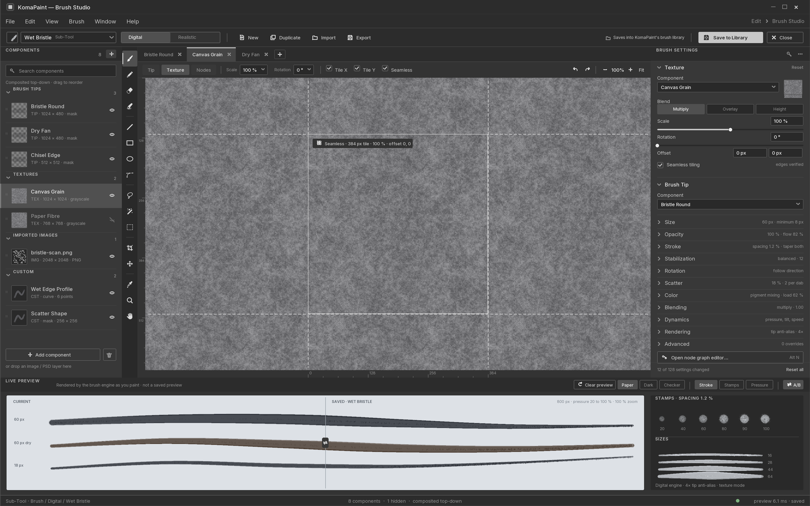

# KomaPaint — Brush Studio (visual mockup)

The two 1728 × 1080 PNGs here are the approved design mockups, not captures
of the running application. The five-region B2 implementation and the
features deferred to later stages are tracked in the
[Brush Studio progress record](../../architecture/brush-studio-progress.md).


This is the third pass. The first was built on the wrong foot: it borrowed a
brush name, an engine label and a layout vocabulary from another painting
program, and the result read as that application with a KomaPaint title bar.
The second rebuilt it entirely on this repository's own theme, icons and
terminology. **This pass refines that second design — the five regions, the
tabbed editor and the palette are unchanged; what changed is what each region
says and how much room it gives.** Nothing in this image comes from outside
this repository.

A second rendering, `brush-studio-texture.png`, shows the same window with the
Texture editor active. It exists because one screenshot cannot show two
editing modes; it is not a second design.



## Where every part comes from

| part of the mockup | source of truth in this repository |
| --- | --- |
| all colours | `ui/themes/KomaTheme.qml` — the dark theme |
| type scale, weights, tracking | `KomaTheme.qml` (`fontMicro`…`fontDisplay1`, `trackingMicro`) |
| spacing, control heights, rails | `KomaTheme.qml` (4 px grid, `controlHeight` 24, `toolButtonSize` 34) |
| menu band, command bar, docks, status bar | `ui/workspaces/MainWindow.qml`, `ui/components/MainToolbar.qml` |
| tool icons (brush, pencil, eraser, …) | the actual PNGs in `ui/assets/icons/tools`, tinted at draw time exactly as `KpIcon` tints them |
| chrome glyphs (new, save, duplicate, close, undo, eye, grip, chevrons, …) | drawn in the `KpGlyph` family: 20-unit grid, 1.7-unit stroke, round caps, one weight |
| terminology | `src/app/SubToolLibrary.h` (Sub-Tool, collections), `BrushSettings` (Digital / Realistic engines), `resources/brush-presets.json` (preset names) |

## Palette discipline

The dark theme has no saturated accent: ink (`#c8c8c8`) carries structure and
selection. This pass removed the one warm note the previous version spent on a
"Realistic is experimental" triangle, so the window now uses **no colour at
all** beyond the theme greys and the two semantic dots in the status bar. The
single light surface is **Save to Library** — the one commit action in the
window, and therefore the one element that reads as a button from across the
room.

Surfaces form the same shallow ladder as the main window: window `#2c2c2c`,
panels `#383838`, wells and fields `#292929`, canvas desk `#454545`, with
one-pixel hairlines wherever structure would otherwise be ambiguous. The
document sits on the theme's own transparency checkerboard
(`transparencyLight` / `transparencyDark`), not a generic one.

## Anatomy

```
┌──────────────────────────────────────────────────────────────────────┐
│ 30  KomaPaint — Brush Studio                          – ▢ ✕           │
│ 30  File  Edit  View  Brush  Window  Help          Edit › Brush Studio│
│ 40  brush▾ Digital│Realistic │ New Duplicate Import Export            │
│     … "Saves into KomaPaint's brush library"  Save to Library · Close │
├──────────┬─────────────────────────────────────────────┬─────────────┤
│ 260      │ 34 rail │ 32 tabs                           │ 340         │
│ COMPO-   │         │ 34 tool options + undo/redo + zoom │ BRUSH       │
│ NENTS    │         │                                    │ SETTINGS    │
│ search   │         │ 1024 × 480 tip mask, selection,    │ 13 groups   │
│ 8 rows   │ 16 ruler│ symmetry guide, rulers             │ 2 open      │
│ + eye    │         │                                    │ 1 more open │
│ + grip   │         │                                    │ in texture  │
│ + add    │         │                                    │ sticky foot │
├──────────┴─────────────────────────────────────────────┴─────────────┤
│ 250  LIVE PREVIEW — CURRENT │ SAVED wipe · stamps · sizes            │
│ 24   status bar — Sub-Tool path · component counts · preview timing   │
└──────────────────────────────────────────────────────────────────────┘
```

### What this pass changed, region by region

**1. The central workspace.** It now has two gateways, as a chip row directly
under the tabs: `Tip`, `Texture`, `Nodes`. That row replaces the previous
"the editor is whatever tab you opened" ambiguity — the tab names the
component, the chip names the activity, and `Nodes` is one tab away instead of
a menu item.

*Tip editing* shows the 1024 × 480 mask at 100 % with a live selection on it
(two-tone marching ants, eight transform handles and a rotation handle), the
symmetry guide the checkbox in the options strip turns on, both rulers in
document pixels, and a format chip above the document. Undo and redo are now
visible, permanent controls at the right end of the options strip rather than
a keystroke you have to remember, and the zoom read-out sits beside them.

*Texture editing* (second image) fills the viewport with the tile **and its
neighbours**, clipped at the viewport edge, so seams are judged where they will
actually be seen. The tile is drawn at 1:1 with a 1 px boundary, the seam grid
is drawn as a dashed guide over it, and `Tile X`, `Tile Y` and `Seamless` sit
in the options strip next to the scale. The component being edited is the same
one selected in the browser — switching mode switches the selection with it.

**2. The component system.** The browser still groups by type, but each row now
carries the four things a stack needs: a drag grip, a thumbnail, the real format
line, and an eye toggle (`Paper Fibre` is hidden and dimmed, and the status bar
counts it). The footer pairs `+ Add component` with a remove action instead of
hiding removal behind a menu, and the header line states the rule the stack
obeys — *composited top-down · drag to reorder*. Nothing in the window caps the
list: the counts are counts, not fractions. A brush is a stack of independent
components, and the browser is that stack.

**3. Live preview.** It is now a comparison instrument. One paper, one set of
stroke paths, painted twice — left of the divider is the brush as currently
edited, right is the saved brush — with a wipe handle you can drag. The two
sides differ in edge dryness and scatter, not in the path, so the comparison is
honest. Above it: `Clear preview`, the canvas background (`Paper`, `Dark`,
`Checker`), the preview mode (`Stroke`, `Stamps`, `Pressure`) and the `A/B`
toggle. To the right, unchanged, the stamp strip at six pressures and the size
ramp; the stroke sheet keeps three sizes and a direction change.

**4. Brush settings.** Same thirteen categories, same expand-on-demand rule,
rebuilt internals. Slider rows now put the label and the value field on one
line with the track beneath, so the track is never cut by the field; controls
are chosen for their job rather than defaulting to sliders — `Taper` is a
three-way chip group (`In / Out / Both`), `Smoothing` is a select (`Balanced`),
`Flip X/Y` and `Seamless tiling` are checkboxes, `Offset` is a pair of numeric
fields, and pressure-to-size is still a curve with draggable nodes. Collapsed
rows carry a value summary (`60 px · minimum 8 px · smooth curve`), which is why
eleven of them fit without scrolling. The sticky footer keeps *12 of 128
settings changed* and one way back.

**5. The command bar.** Groups are now separated by rules and ordered by
consequence: identity (brush name, Sub-Tool kind, engine), management (`New`,
`Duplicate`, `Import`, `Export`), action (`Save to Library`, `Close`). The
destination is spelled out immediately before the button — a folder glyph and
*Saves into KomaPaint's brush library* — so "where does this go" is answered
before the click rather than after it.

**6. Node editing.** Still exactly one entrance — a row under `Advanced`
(`Open node graph editor… Alt N`) — plus the third chip in the editor. It is a
separate workspace and never the default screen.

## Details worth a second look

- The window is 1728 × 1080 at 1× and rendered at 2× then downsampled, so
  hairlines, ants and glyph strokes stay crisp.
- The tip mask is generated as a field, not as scattered dabs: bristle
  striations run with the bristles, the ends taper, and the four thin strokes
  under it are the wet-edge profile painted with the same tip.
- The texture is periodic by construction (value-noise octaves built from
  wrapped grids), so the tiling preview shows a genuinely seamless edge — if it
  were not, you would see a repeat.
- The right panel fits its content with 20 px to spare in tip mode; the
  numbers the renderer prints when it runs are the check against silent
  overflow.

## Regenerating

`brush-studio-mockup.py` renders both PNGs deterministically: Pillow and numpy,
plus Inter 400/500/600. Icons are read straight from
`ui/assets/icons/tools`, so the mockup cannot drift from the app's icon set.

```
KOMAPAINT_MOCKUP_FONTS=/path/to/inter-ttf \
python3 docs/design/brush-studio/brush-studio-mockup.py
```

It prints how many pixels the settings panel consumed per mode, which is the
fastest way to catch a layout that no longer fits. It is a design artefact, not
a build dependency.

## Open questions for review

1. The editor's mode chips (`Tip` / `Texture` / `Nodes`) duplicate the tab
   strip's job when only one component is open. Should they stay as a mode
   switch, or collapse into the tab when a component is selected?
2. Preview is 250 px. At 1080p that is comfortable; on a 768 px-tall laptop it
   would have to collapse. Should it become a collapsible strip, or a tab of the
   settings panel, at small heights?
3. The command bar's destination line is stated once per window. Should the
   button itself carry it after the first save (`Saved to Brushes ✓`), or stay
   verb-first and let the hint do the work every time?
