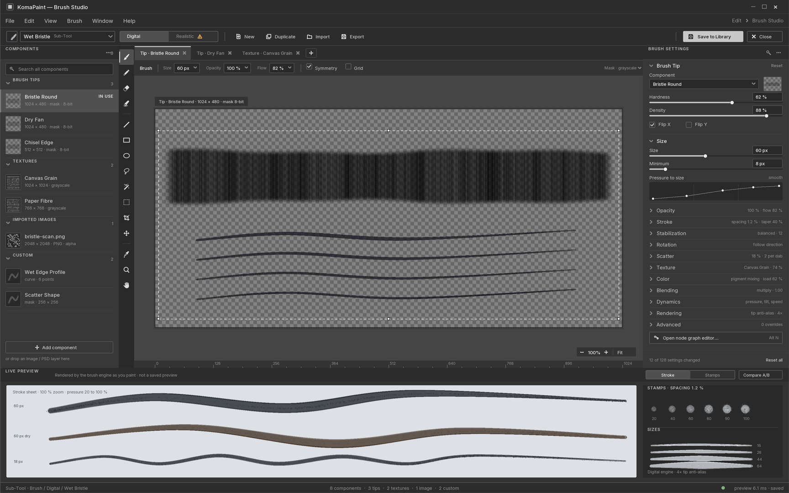

# KomaPaint — Brush Studio (visual mockup)

`brush-studio.png` (1728 × 1080) is a design mockup. No application code was
written or changed for it: nothing here is wired into `src/` or `ui/`, and
Brush Studio does not exist yet.



This is the second take. The first was built on the wrong foot: it borrowed a
brush name, an engine label and a layout vocabulary from another painting
program, and the result read as that application with a KomaPaint title bar. It
has been replaced rather than patched. Nothing in this image comes from outside
this repository.

## Where every part comes from

| part of the mockup | source of truth in this repository |
| --- | --- |
| all colours | `ui/themes/KomaTheme.qml` — the dark theme, "ink and ember" |
| type scale, weights, tracking | `KomaTheme.qml` (`fontMicro`…`fontDisplay1`, `trackingMicro`) |
| spacing, control heights, rails | `KomaTheme.qml` (4 px grid, `controlHeight` 24, `toolButtonSize` 34) |
| menu band, command bar, docks, status bar | `ui/workspaces/MainWindow.qml`, `ui/components/MainToolbar.qml` |
| tool icons (brush, pencil, eraser, …) | the actual PNGs in `ui/assets/icons/tools`, tinted at draw time exactly as `KpIcon` tints them |
| chrome glyphs (new, save, duplicate, close, chevrons, …) | drawn in the `KpGlyph` family: 20-unit grid, 1.7-unit stroke, round caps, one weight |
| terminology | `src/app/SubToolLibrary.h` (Sub-Tool, collections), `BrushSettings` (Digital / Realistic engines), `resources/brush-presets.json` (preset names) |

That is why the rail carries real KomaPaint tool artwork and not look-alike
icons, and why the settings rows and the command bar use the same hairlines,
the same 24 px controls and the same two accents as the main window.

## Palette discipline

The dark theme has no saturated accent: ink (`#c8c8c8`) carries structure and
selection, and the ember accent is `warning` (`#d2a054`), used exactly once —
on the Realistic engine, which is the experimental one. Consequently the window
has a single light element, **Save to Library**, and that is deliberate: one
commit action, no rainbow of buttons.

Surfaces form the same shallow ladder as the main window: window `#2c2c2c`,
panels `#383838`, wells and fields `#292929`, canvas desk `#454545`, with
one-pixel hairlines wherever structure would otherwise be ambiguous. The
document sits on the theme's own transparency checkerboard
(`transparencyLight` / `transparencyDark`), not a generic one.

## Anatomy

```
┌──────────────────────────────────────────────────────────────────────┐
│ 30  KomaPaint — Brush Studio                          – ▢ ✕           │
│ 30  File  Edit  View  Brush  Window  Help          Edit › Brush Studio│
│ 40  brush · engine · New Duplicate Import Export … Save · Close       │
├──────────┬─────────────────────────────────────────────┬─────────────┤
│ 260      │ 34 rail │ 32 tabs                           │ 320         │
│ COMPO-   │         │ 34 tool options                    │ BRUSH       │
│ NENTS    │         │                                    │ SETTINGS    │
│ search   │         │ 1024 × 480 tip mask at 100 %       │ 13 groups   │
│ tips     │         │ + four pressure tests              │ 2 open      │
│ textures │ 16 ruler                                    │ sticky foot │
│ images   │                                    zoom pill │             │
│ custom   │                                             │             │
├──────────┴─────────────────────────────────────────────┴─────────────┤
│ 250  LIVE PREVIEW — stroke sheet in three directions · stamps · sizes │
│ 24   status bar — Sub-Tool path · component counts · preview timing   │
└──────────────────────────────────────────────────────────────────────┘
```

**Components.** Grouped, not one flat list: Brush Tips, Textures, Imported
Images, Custom, each with a count, a chevron and rows carrying a thumbnail,
a name and its real format line (`1024 × 480 · mask · 8-bit`,
`2048 × 2048 · PNG · alpha`). The brush's active tip is marked *in use* with
the theme's selection fill and a 2 px accent bar. Tip thumbnails sit on the
transparency checker so a mask reads as a mask.

**The editor.** It is the largest region on the screen and it behaves like a
canvas, not a form: the authored tool rail, a tool-options strip (size,
opacity, flow, symmetry, grid, mask channel), rulers in document pixels, a
zoom control and a marching-ants selection with corner and edge handles. The
tab strip names the component being edited, and a floating chip repeats the
mask's format, so "what am I editing" is never ambiguous. The four strokes in
the mask are pressure tests of the tip, which is what an artist actually does
in this window.

**Settings.** Thirteen collapsible categories, each closed to one line with its
current values as a summary, so the panel is scannable rather than a wall of
sliders. Two are open — Brush Tip (component picker, hardness, density, flips)
and Size (size, minimum, and a pressure-to-size curve). A sticky footer counts
what changed and offers one way back.

**Preview.** Given 250 px, a third of the window's left column width: a stroke
sheet at 100 % with three different sizes and directions, a stamp strip showing
the same dab at six pressure steps with its spacing, a size ramp, and the
engine line. It is deliberately labelled as rendered by the brush engine while
you paint, not a saved preview.

**Advanced.** Node editing appears exactly once, as a row under `Advanced`
("Open node graph editor… Alt N") with a note-free footer. It is a separate
workspace and never the default screen.

## Compared against the previous attempt

| previous | now |
| --- | --- |
| brush named after another program | `Wet Bristle`, a normal KomaPaint Sub-Tool |
| "Pixel Engine" terminology | **Digital / Realistic**, the engines `BrushSettings` actually defines |
| hand-drawn look-alike icons | the repository's own tool PNGs, tinted by `KpIcon` rules |
| no menu band | the main window's menu band, with the `Edit › Brush Studio` entry visible |
| 152 px preview | 250 px, with stamps and size ramps |
| flat component list | grouped browser with formats and *in use* state |
| 1600 × 1000 | 1728 × 1080, a realistic desktop size |

## Regenerating

`brush-studio-mockup.py` renders the PNG deterministically: Pillow and numpy,
plus Inter 400/500/600. Icons are read straight from
`ui/assets/icons/tools`, so the mockup cannot drift from the app's icon set.

```
KOMAPAINT_MOCKUP_FONTS=/path/to/inter-ttf \
python3 docs/design/brush-studio/brush-studio-mockup.py
```

It is a design artefact, not a build dependency.

## Open questions for review

1. Should the engine selector stay in the command bar (visible while switching)
   or move into the settings panel as its own first group, leaving the bar for
   brush actions only?
2. The component browser groups by type. Should it instead show composition
   order (the stack that actually composites into the tip), with type as a
   badge? Grouping by type is easier to scan; order is more truthful to how the
   brush is built.
3. Preview is 250 px. At 1080p that is comfortable; on a 768 px-tall laptop it
   would have to collapse. Should it become a collapsible strip, or a tab of the
   settings panel, at small heights?
