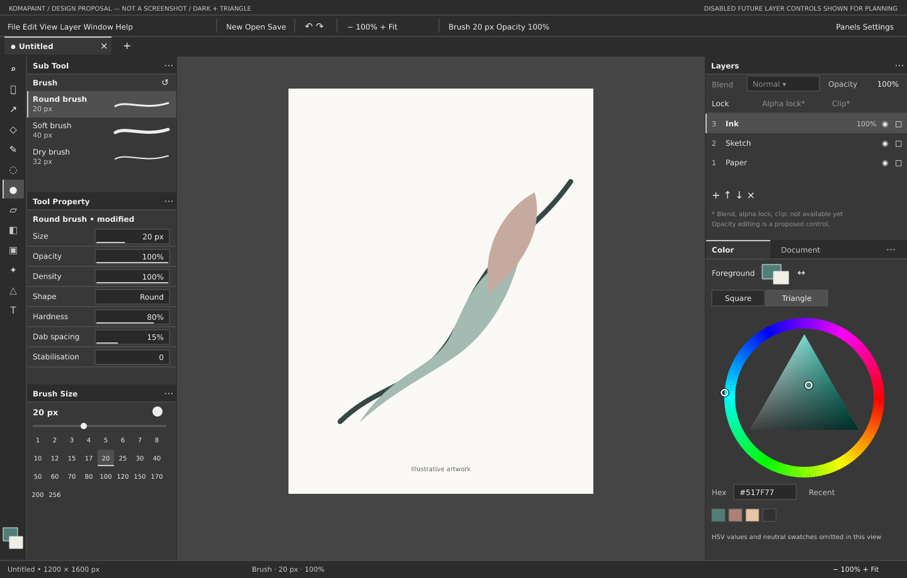
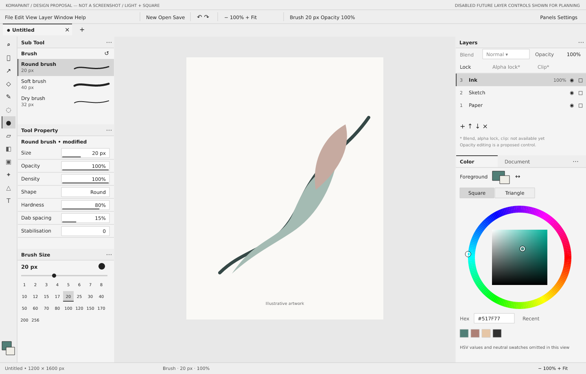

# KomaPaint interface proposal — revision 2: compact desktop workflow

**Design proposal only — no implementation.** [Revision 3](komapaint-interface-design-proposal-revision-3.md) supersedes this revision's parameter, size-grid and layer-thumbnail proposals; its new mockups correct the omissions identified by the user. This revision responds to the user's two CSP reference images and direct feedback. It supersedes the initial proposal's separate menu/toolbar rows, two-column default tool rail, spacious tool-property layout, untabbed document properties, outlined paper and vertical hue strip. The previous proposal's neutral token tables, accessibility guidance, component-preservation requirements and design-only status remain applicable where not contradicted here. [Initial proposal](komapaint-interface-design-proposal.md) · [Research and source evidence](professional-software-design-research.md).

The images inform **density, adjacency, docked tabs and efficient desktop space use**; they do not authorize copying CSP's icons, interface, assets or blue highlights. The point is an efficient KomaPaint workflow, not a lookalike. No bright accent colours in chrome; actual artwork, swatches, previews and the functional colour picker remain in colour.

## 1. Revised static visualizations





[Dark vector](design-proposal/compact-dark-triangle-proposal.svg) · [Light vector](design-proposal/compact-light-square-proposal.svg)

**These images are noninteractive design proposals, not screenshots.** The top caption and explanatory notes inside Layers are mockup annotations, not proposed permanent chrome. The colour-mode choice is independent of theme: **either shape should be available in either theme**. The wheel and triangle gradients are schematic representations of functional colour data, not an accurate colorimetric implementation. The selector, swatch, hex and ring marker are illustrative, not guaranteed to represent a mathematically consistent single colour. Brush strokes are placeholders for the existing actual preview, not a replacement; layer names/artwork are fictional. Tool glyphs are symbolic stand-ins for existing assets. Some existing commands, controls, scroll content and viewport affordances are omitted to keep the composition legible; the preservation list is authoritative. In particular, the mockup does not show the full colour controls or every layer action. The layer feature controls shown greyed are **not operational in the current application** (details in §3).

## 2. Layout decision

```text
BEFORE — first proposal                    REVISION 2 — denser desktop proposal
┌ KOMAPAINT | File Edit View … ─────┐     ┌ File Edit View … | New Open Save | edit/view/brush ─┐
│ New Open Save | edit / view …    │     │ document tab •                                      │
│ document tab •                   │     ├rail┬ Sub Tool       ┬ canvas ─────────┬ Layers ─────┤
├rail 2col┬ Sub Tool ┬canvas┬Layers┤     │one │ presets + stroke│                 │ blend /     │
│         │ Tool    │      │Props │ →   │col │ Tool Property   │ artwork         │ opacity     │
│         │ Property│      │Color │     │    │ compact rows    │ no black edge   │ alpha / clip│
│         │ Brush   │      │      │     │    │ Brush Size      │                 │ layer list  │
│         │ Size    │      │      │     │    │                 │                 ├─────────────┤
│         │         │      │      │     │    │                 │                 │ Color | Doc │
│         │         │      │      │     │    │                 │                 │ hue ring +  │
│         │         │      │      │     │    │                 │                 │ square/tri  │
└ status ──────────────────────────┘     └────┴─────────────────┴─────────────────┴─────────────┘
```

The right-side interpretation is deliberate: **Layers remains visible above a lower tab group, with Color and Document as browser-like tabs**. “Document” is the existing document Properties panel, not a new layer-properties panel; its content is shown when that tab is selected. It also remains accessible from the View/Window panel list, using whichever menu currently owns panel visibility. This changes the *proposed default arrangement* from the original proposal; existing saved/customized layouts must not be reset or overwritten. If “tab under layers” meant a different placement, confirm before implementation.

## 3. Layers: controls at the point of work

### 3.1 Proposed panel

```text
┌ Layers ───────────────────────────────┐
│ Blend [Normal ▼]*    Opacity [100 %]† │
│ Lock  [Alpha lock]*  [Clip]*          │
├───────────────────────────────────────┤
│ ▏ 3   Ink                   ◉    lock │
│   2   Sketch                ◉    lock │
│   1   Paper                 ◉    lock │
│                                       │
│ +   [existing actions]   ↑  ↓    ×    │
└───────────────────────────────────────┘
* Not yet supported; shown disabled in concept, not an active promise.
† Current model has opacity; an editing control is proposed, not present in this panel today.
```

- Put blend mode and opacity next to each other at the top of Layers, with lock, alpha-lock and clip immediately below. The layer list and current raster/add/delete/move controls remain directly underneath; preserve other existing unavailable actions and their explanation even if the diagram omits them.
- Use a compact 28–30 logical-unit row for each toolbar, 30–32-unit layer rows, 8-unit panel inset and 2–4-unit gaps. Names 12–13 units; values right-aligned; icons have a 28–32-unit hit area even if visible artwork is smaller. No mock thumbnail until real layer previews exist.
- Selected layer uses neutral fill + leading edge; hover/pressed/focus follow the shared grammar in the initial proposal. Disabled future features must be labeled as unavailable with accessible explanations, not merely a faint icon. In the **mockup** their extra annotation is visible; a future real interface would use a disabled state and accessible explanation rather than presenting a fake working control.
- Keep visibility, ordinary lock, model ordering, current layer selection, real raster actions and existing edit/undo/serialization behavior. Do not enable feature-looking controls without an end-to-end implementation.

### 3.2 What exists versus what is requested

| Requested item | Baseline source observation | Design status / future dependency |
|---|---|---|
| Layer opacity | [`src/layers/Layer.h`](../../src/layers/Layer.h) has an opacity property; [`src/app/CanvasViewport.cpp`](../../src/app/CanvasViewport.cpp) passes it to the compositor. [`ui/panels/LayersPanel.qml`](../../ui/panels/LayersPanel.qml) displays the selected row's percentage but does **not** expose an opacity editing control. | A visible, editable selected-layer opacity value beside blend mode is a proposed new control, not a currently working UI. Test value changes, composition, history, save/reopen and recovery before shipping; preserve existing model behavior. |
| Blend modes | Inspected [`Layer.h`](../../src/layers/Layer.h) has no blend-mode property; [`CpuTileCompositor.cpp`](../../src/canvas/CpuTileCompositor.cpp) performs normal source-over composition. | The disabled “Normal” field indicates planned placement only. Multiply/Overlay and other modes need documented compositing semantics, state, rendering, persistence, undo/recovery and tests. Do not make a dummy menu look usable. |
| Alpha lock | Existing [`LayersPanel.qml`](../../ui/panels/LayersPanel.qml) has a **disabled** “Lock transparent pixels” action; ordinary layer lock is separate and working. | Show the planned control by opacity; activation requires real paint-engine enforcement, state, persistence and undo semantics. Don't equate whole-layer lock with alpha lock. |
| Clipping | No clipping-layer/mask state was found in the inspected layer model/compositor. The existing disabled “Layer mask” action is **not evidence of clipping support**. | Reserve a disabled control beside opacity/alpha lock; future work must define whether it clips a layer to the one below or means a distinct mask, and implement renderer, state, file format, undo/recovery and tests. |

None of these features is approved for implementation by this design revision. Even the opacity editor would be a new UI behavior, not a pure restyle. The mockups don't pretend their disabled controls work.

## 4. One top row, compact tool controls

### Main menu and commands

- Combine the menu headings and existing quick actions in **one 32–36-unit row**: File / Edit / View / Layer / Window / Help, then compact New/Open/Save, Undo/Redo, zoom and brush-value groups where space permits. Menu access remains; these are two access paths in the *same row*, not duplicate rows. Exact menus/actions must follow the existing application, not the mockup's abbreviated labels.
- Remove the oversized “KOMAPAINT” wordmark/tab from application chrome. Keep application identification in the native window title and normal application metadata; the all-caps label above the mockup is only a proposal caption, outside the illustrated application.
- Maintain every existing command, shortcut and group visibility preference. At reduced width, compact/overflow quick actions before they collide; keep all commands available through existing menus/shortcuts and preserve current brush panel access. An overflow mechanism is **proposed**, not claimed to exist. Validate real menu width, translations, high DPI and large text before deciding a breakpoint; don't silently hide irreplaceable controls.
- Keep document tabs directly below the merged row, with an independent unsaved marker and the existing close/new behaviors. A 30–32-unit strip is not another command bar.

### Tool rail

- Default to a **single vertical strip**: 34-unit cells, one tool per row, roughly 42 units including outer inset. This is a layout change, not a smaller click target. Preserve tool order, availability, foreground/background swatches, swap/reset and tooltips; use scrolling when the window height cannot show every tool. If a user widens the rail, allow a two-column presentation only as a future responsive option, without changing the selected tool or hiding entries.
- The active tool has a neutral selected fill and edge, separate from the focus outline. Disabled tools remain distinguishable and explainable. Existing icons are retained; the generic glyphs in the mockup are not proposed assets.

### Tool Property / Brush Size

- Replace the previous proposal's tall stacked label/rail/value pattern with **compact rows**: label left; editable numeric value on the right; a subtle inline level/rail within the value field or same row. Size, opacity and density appear together; shape, hardness, dab spacing and stabilisation follow. Each row is 28–32 logical units, with 2–4-unit gaps; grouped by task with minimal whitespace, not a rule and header after each line.
- The visible rail can be thin; the interaction target around it must remain at least 28 logical units high. Do not reduce the 12–13-unit label text or turn the only numeric value into an unreadable micro-label. Maintain a distinguishable slider thumb/position, direct typing, keyboard, wheel, fine adjustment, reset where supported and nonlinear brush-size curve. If a compact row cannot contain both a usable rail and typed field at a narrow width, wrap within the same row group or scroll, rather than clipping controls.
- Keep Sub Tool with the existing settings-based stroke previews. Align names and actual sizes consistently and remove excessive padding, but do not replace the parameter-driven `BrushStrokePreview` approximation with decorative curves. It is a QML-drawn approximation, not the brush engine's rendered output; see revision 3. Keep Brush Size's current readout, preview, continuous rail and complete step grid; use a compact grid with adequately sized hit areas and scrolling/wrapping as needed.
- Preserve all current tool-dependent visibility and `Workspace.brush`/preset synchronization. The mockup shows the main controls but omits some existing explanatory and interaction details.

## 5. Colour: square or triangle within a hue ring

### Proposed interaction

```text
┌ Color | Document ────────────────────┐
│ foreground/background + swap          │
│ [Square] [Triangle]                   │
│             HUE RING                  │
│          ┌───────────┐    or   /\     │
│          │ S / V     │        /  \    │
│          └───────────┘       /____\   │
│ Hex, H/S/V, recent and neutral colours│
└───────────────────────────────────────┘
```

- Offer a persistent **Square / Triangle** choice in the Color panel; both modes use the same draggable hue ring, not a vertical hue strip. Square is a true 1:1 saturation/value field, not a stretched rectangle. Triangle has a hue ring around an HSV triangle. The controls and choice work in **both** neutral themes.
- In square mode map horizontal position to saturation, vertical to value (top = 1, bottom = 0). In triangle mode use vertices for the chosen pure hue, white and black: use barycentric weights `h`, `w`, `b` (sum 1), with HSV value `V = h + w`, saturation `S = h / V` for `V > 0`. The equivalent weighted RGB construction is in HSV's encoded component space, not linear-light colour mixing. For `V = 0`, retain the previously selected hue and choose a defined neutral saturation behavior. The displayed RGB colours must be computed consistently with the application's HSV conversion, not inferred from the illustrative SVG gradients. Coordinate mapping, clipping, gamut and marker behavior are to be tested.
- Dragging the hue ring changes hue while preserving the selected S/V; dragging the field changes S/V without altering the hue. Switching shape **does not change foreground RGB/HSV, background, previous hue for greys, or colour history**. The same `Workspace.colors` foreground remains the single authority; a mode switch is presentation state only. Preserve text/HSV/hex inputs, recent/neutral swatches, swap/reset, tool rail colour pair and their existing history rules.
- Proposed mode preference is per user, remembered between sessions; this persistence is **new planned UI state**, not current behavior. When space is narrow, scale the ring and field together while keeping pointer/touch targets usable, then scroll or allow panel resizing; do not distort the square or triangle.
- Hue/field markers use a two-tone ring so they remain visible against any actual colour; focus receives a distinct neutral focus outline, keyboard access and accessible labels/value announcements. Hover/press/disabled rules remain separate from the selected marker. Functional HSV gradients and colour swatches are explicitly allowed; no gradients in neutral chrome.
- **Current baseline:** [`ColorPanel.qml`](../../ui/panels/ColorPanel.qml) has a rectangular HSV plane and vertical hue rail with hex/HSV controls and session history. The wheel, triangle, square mode selector, persistence and new keyboard mapping are **future features/design proposals**, not currently available. Ensure selecting/swapping/typing colours remains accurate; no control is to claim to work until implemented and tested.

## 6. Document properties, dock tabs and paper edge

- In the proposed default layout, the lower right group contains browser-like **Color** and **Document** tabs beneath Layers. The active tab joins its body; use a neutral active edge, legible inactive labels, hover/pressed states and a separate focus outline. This is a real dock group concept, not a decorative header; dragging, floating, hiding and restoring panels remain possible. The existing Properties panel is accessible through the application's existing panel visibility menu. Whether the display name should be “Document” or “Properties” is an open wording decision; stable internal panel ID remains `properties`.
- Selecting Document reveals the existing title, dimensions, resolution, background and At a glance fields with their original editable/read-only semantics. Do not remove the panel, change project data or substitute a fabricated layer-properties panel. Since this changes the **proposed default topology**, don't reset or rewrite existing saved user layouts; verify tab visibility and restoration in any later authorized implementation.
- Remove the visible **black/dark outline around white paper**. The page boundary is the tonal difference between artwork and the neutral surround, with no line or shadow baked into the artwork. Transparent canvas retains the existing checkerboard, and a neutral surround is still visible. If artwork matches the surround exactly, test a non-black, non-permanent boundary aid only if needed for navigation; it must not alter/export pixels. This is an open validation issue, not permission to restore the black line by default.

## 7. Common styling and unaffected areas

- Continue the strict grayscale dark/light token roles from the [initial proposal](komapaint-interface-design-proposal.md#3-visual-foundation). No accent colours, glows, colourful borders or ornamental gradients. Use density, typographic weight and local neutral state to create hierarchy. Colour is allowed only when it is meaningful content or a functional colour selector.
- No oversized application branding, cards, nested panel tiles, excessive padding or mobile-scale forms. Equally, no tiny targets, inaccessible labels, concealed current state or removal of useful controls merely to increase density. Document tabs, menu/keyboard behavior, files, brush settings, layers, colour, docking and recovery remain protected.
- New Project, other menus/popups and shared-control specifications continue from the initial proposal, subject to the denser desktop rhythm and same monochrome states. The animation model remains incomplete: no polished imaginary timeline, no new playback/exposure claims.

## 8. Sequence after approval, dependencies and risks

1. **Validate compact structure with a real baseline** at small/large windows, scaling, translation and pen/mouse/keyboard use. Record existing layouts before changing defaults; agree on properties-tab placement and selector semantics.
2. **Neutral shared states and compact control primitives**, then merged top row and one-column tool rail. Verify command availability/overflow, shortcuts, large text, target sizes, no lost swatches and accessibility.
3. **Compact existing tool properties and brush panels** without changing `Workspace.brush` or preview logic. Compare all ranges, curve, keyboard/drag/wheel/fine editing and tool-change synchronization.
4. **Right-side dock/tab arrangement and borderless paper presentation.** Test saved/custom layouts, panel menu discovery, float/tab/collapse, document data, transparency and canvas/export unchanged. Do not reset existing layouts.
5. **Colour selector redesign** as a separately scoped functional addition: accurate shared HSV state, square/triangle math, hue ring input, mode persistence, keyboard access, all existing fields/history and both themes. Compare sample values and hue retention across mode switches; confirm no new history entries for presentation-only changes.
6. **Layer feature work is separate from styling:** opacity editor first only after history/file/recovery semantics are checked; blend modes, alpha lock and clipping each require model/rendering/persistence/undo work and dedicated tests. Until then, do not falsely activate controls. The exact scope/order of these features needs approval.
7. **Full desktop visual and interaction verification**: all proposed states, adequate focus and contrast against both themes and variable colour, native scaling, long labels, scrolling and real artwork; compare task speed and error rate, not just screenshots.

## 9. Questions to confirm before implementation

1. Is **Layers above, then Color / Document tabs below it** the intended “tab under layers” arrangement, or do you want Layers and Document as tabs in the *same* group?
2. Does “clipping mask” mean the selected layer clipped to the layer directly below, or a separate editable mask? This affects rendering and storage.
3. Should unsupported blend / alpha-lock / clipping controls be shown disabled for discoverability, or omitted until the features actually work? The diagrams show disabled to make the requested future placement clear.
4. Is **one-column tool rail by default** the intended response to your “vertical strip” request, with optional wider/two-column layout only if later useful?
5. Is the default selector **triangle + hue ring** acceptable, with square selectable, or should square be the default? The mockups show both; neither image fixes the default.
6. Should toolbar brush/zoom quick controls stay in the combined top row when space allows? They are retained here to avoid silently losing existing access; menus and panel editing remain available when compacted.

**Stop for review.** No application code, QML, C++, themes, components, application assets, commits or pushes were changed. The new PNG/SVG files are documentation-only proposal mockups.
