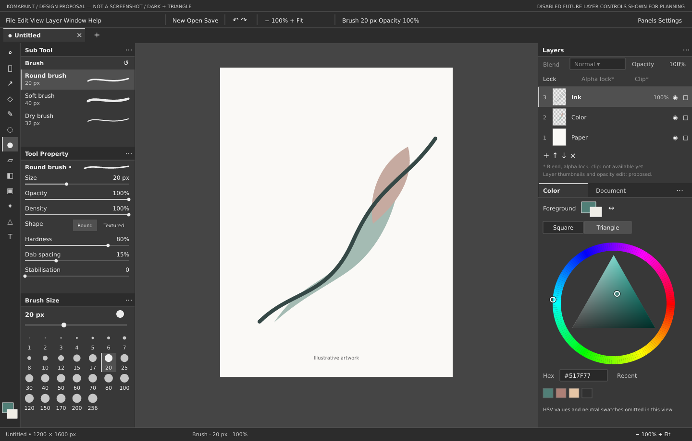
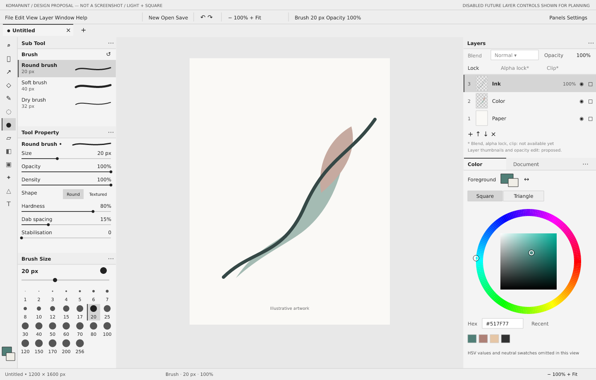

# KomaPaint interface proposal — revision 3: brush controls and layer previews

**Design and research only; not implemented.** [Revision 4](komapaint-interface-design-proposal-revision-4.md) refines the top-bar brush readout and tool-rail alignment; this revision remains the proposal for brush controls and layer previews. This revision supersedes the tool-property, brush-size and layer-list treatments in [revision 2](komapaint-interface-design-proposal-revision-2.md). The combined top row, compact tool rail, right-side panel/tab interpretation, monochrome chrome and colour-selector proposal from revision 2 remain design proposals—not approvals to implement. Preserve document, painting, colour, layer, docking and recovery behavior. No application code, QML, C++, theme, component or application asset changes are made.

## 1. Correction and revised mockups

The previous mockup was wrong in two important ways: it replaced the useful brush-size **discs** with numbers alone, and showed a layer list without previews. It also made the brush parameters resemble a column of little text boxes. The [current BrushSizePanel](../../ui/panels/BrushSizePanel.qml) already draws size discs; the mockup should not have removed them. The current Layers panel does **not** yet provide artwork thumbnails, so thumbnails below are a concrete requested **future feature**, not an existing capability.





[Dark vector](design-proposal/brush-layer-dark-triangle-proposal.svg) · [Light vector](design-proposal/brush-layer-light-square-proposal.svg) · [Brush controls at 2×](design-proposal/brush-controls-detail-proposal.png) · [Layer previews at 2×](design-proposal/layer-previews-detail-proposal.png)

The mockups are **static illustrations, not screenshots**. Fictional thumbnail artwork is drawn from the same illustrative scene components to show the relationship between layer content and canvas; it is not a KomaPaint-generated thumbnail. The actual app has no thumbnail pipeline yet. Stroke samples are illustrative paths, not output of the app; glyphs stand in for existing icons. Layer controls marked as unavailable and an opacity editor remain future proposals (see revision 2). The caption and explanatory note in the mockup are annotations, not permanent interface elements. The mockup shows the Round/Textured choice schematically; actual target sizes and complete choice labels must follow §3.2. It omits some controls, scrollable content, overlays and states—nothing omitted should be removed from the real application. Colour picker geometry is illustrative, not a functional or colorimetrically verified picker. Neither theme nor selector shape is fixed by these images.

## 2. Targeted recheck: what these applications actually do

This is a focused source/documentation check, not a general competitor survey. The user-provided CSP screenshots remain useful visual references; no product UI is to be copied. No applications were run. External source links are pinned to the same revisions used in the [research report](professional-software-design-research.md#10-source-code-research-scope-and-reproducibility); Harmony is proprietary and only official documentation/images were reviewed.

| Application | Verified observation | Decision for KomaPaint and limitation |
|---|---|---|
| **Krita** | The official [Layers docker reference and screenshot](https://docs.krita.org/en/reference_manual/dockers/layers.html) show a compact top control area, then a layer stack with per-layer miniature image, names and row actions; it documents adjustable thumbnail size. I visually inspected its [actual Layers screenshot](https://docs.krita.org/en/_images/Krita_Layers_Docker.png). [`LayerBox.cpp`](https://github.com/KDE/krita/blob/70b9b38db4031a1fa9558867be056396f7022c97/plugins/dockers/layerdocker/LayerBox.cpp#L322-L351) configures thumbnail size; [`KisNodeModel`](https://github.com/KDE/krita/blob/70b9b38db4031a1fa9558867be056396f7022c97/libs/ui/kis_node_model.cpp#L636-L650) supplies thumbnail roles. [`KisLayerThumbnailCache`](https://github.com/KDE/krita/blob/70b9b38db4031a1fa9558867be056396f7022c97/libs/ui/KisLayerThumbnailCache.cpp#L18-L87) regenerates based on node sequence/size in idle jobs. Its [brush guidance](https://docs.krita.org/en/user_manual/loading_saving_brushes.html) documents slider adjustment and right-click numeric input; [`kis_slider_spin_box_p.h`](https://github.com/KDE/krita/blob/70b9b38db4031a1fa9558867be056396f7022c97/libs/widgetutils/kis_slider_spin_box_p.h#L618-L636) paints value text over the slider fill. | Actual layer content is a primary identification aid. Use cached, aspect-preserving previews rather than generic layer symbols. Avoid imitating its coloured selection. Krita's combined field demonstrates compactness, but we retain an explicit visible thumb and direct numeric affordance for discoverability, not its exact widget or gestures. |
| **OpenToonz** | Its [Tool Options documentation](https://opentoonz.readthedocs.io/en/latest/interface_overview.html#tool-options-bar) describes context-specific settings and a scrollable bar, with an [official bar image](https://opentoonz.readthedocs.io/en/latest/_images/UI_tooloptionsbar.png). In the pinned [`ToolPropertiesPanel`](https://github.com/opentoonz/opentoonz/blob/35f17defecab11bd9af69d24ea44eaf66b5a67f9/toonz/sources/toonz/toolpropertiespanel.cpp#L1130-L1204), Size is bound to the current tool's property and its actual type, including min/max pairs where relevant. [`DoubleValueField`](https://github.com/opentoonz/opentoonz/blob/35f17defecab11bd9af69d24ea44eaf66b5a67f9/toonz/sources/toonzqt/doublefield.cpp#L113-L174) connects a line edit, roller and slider to one value. Its [Level Strip](https://opentoonz.readthedocs.io/en/latest/editing_animation_levels.html#using-the-level-strip) previews drawings of an animation level; [`filmstrip.cpp`](https://github.com/opentoonz/opentoonz/blob/35f17defecab11bd9af69d24ea44eaf66b5a67f9/toonz/sources/toonz/filmstrip.cpp#L960-L970) requests frame icons from `IconGenerator`. | Tool controls should reflect the **current** tool and share one value, without inventing separate model state. A drawing-frame thumbnail is not the same thing as a raster-layer thumbnail, and OpenToonz's min/max pressure options must not be fabricated in KomaPaint. The official bar image is linked but was not visually inspected in this pass. |
| **Harmony 22 Essentials** | I visually inspected the [official Brush Tool Properties screenshot](https://docs.toonboom.com/help/harmony-22/essentials/Resources/Images/HAR/Reference/tool-properties/brush-tool-properties-ess.png): it presents a brush-tip/stroke preview, size control and named stroke list together. [Official documentation](https://docs.toonboom.com/help/harmony-22/essentials/reference/tool-properties/brush-tool-properties.html) describes the preview, maximum-size slider and preset views. [Harmony 22 Premium timeline thumbnails](https://docs.toonboom.com/help/harmony-22/premium/paperless-animation/display-timeline-thumbnails.html) preview drawings **at animation frames**, a different concept from still-image layer content. | Keep an identifiable stroke next to the preset name and preserve KomaPaint's live tip and size ladder. Do not import Harmony's brush engine, proprietary implementation, editing features, or animation thumbnails by implication. |

**Evidence boundaries:** the comparative screenshot/documentation establishes what the examples show or describe, not that a design is faster for KomaPaint. Source code and official pages belong to their respective projects; this proposal copies no source or interface. The product-specific distinctions above matter: layer thumbnails, level drawings and timeline-frame previews serve different contexts.

## 3. Brush controls — corrected design

### 3.1 Before → after

```text
REVISION 2 (rejected)               REVISION 3 (proposed)
Size       [       20 px]            Size                         20 px  ↕
Opacity    [        100%]           ━━━━━━━━━●─────────────────────────
Density    [        100%]           Opacity                        100%  ↕
                                    ━━━━━━━━━━━━━━━━━━━━━━━━━━━━━━●
Brush Size                          … same structure for real parameters …
20 px     ●                         Brush Size        20 px   [tip]
1  2  3  4  5 …                    ────────────●──────────────────────
(numbers only)                      ·    •    ●    ●    ●    ●    ●
                                    1    2    3    4    5    6    7
                                    … all 26 labeled discs …
```

### 3.2 Parameters: readable instrument rows, not a stack of boxes

- **Layout:** current tool/preset heading and existing actual `BrushStrokePreview` stay available; then Size, Opacity and Density, followed by the existing Shape, Hardness, Dab spacing and Stabilisation. One parameter has a label left and its value + unit right, with a thin visible track and a small high-contrast position thumb directly below, within a **32-unit row**. This is shorter than the current 40-unit `PropertySlider` plus group spacing, but is not a 20-unit mobile-style touch field. Use 12–13-unit label/value text, 8-unit side inset and no outlined box around each resting row. Small gaps or typography distinguish existing groups without heavy bands.
- **Shape:** keep the existing Round/Textured choice and both labels or clearly named icons; the current selection uses a neutral fill + marker and a separate focus outline. At narrow widths stack or scroll rather than losing either option. This is not another numeric slider.
- **Editing and hit zones:** the right-aligned value is an actual `KpNumberField`-style editable value, not merely a label. Give it a subtle neutral field boundary on hover/focus and a visible edit affordance/tooltip; Enter or click enters direct numeric editing. The track retains an obvious thumb and a minimum 28-unit-high hit region; avoid overlap with the value field's hit area. Dragging the track, Shift fine drag, wheel, keyboard, Home/End and double-click reset *where currently supported* retain their existing behavior. Tab to track or value independently with a distinct focus cue. No new range or curve: size preserves its non-linear mapping; others retain their existing mappings and units. Test conflict between click-to-jump and text editing before approval.
- **States:** neutral track, readable fill/knob and value; hover only raises contrast, press does not move surrounding layout; focused track/value gets an independent 2-unit outline; disabled rows keep a reason and don't accept edits. A selected preset or live value is not keyboard focus. Inputs and target areas remain usable at scale and with a pen.
- **Why this is better in principle:** the label, value and gesture describe one setting at a glance, without the previous mockup's boxed-column appearance or the current 40-unit-plus-group spacing. Visible tracks, values and thumbs retain discoverability. This is a hypothesis to validate, not a measured usability win.
- **Preserve:** tool-dependent context, `Workspace.brush`, all existing brush values/ranges, preview, preset modified/reset state, toolbar synchronization, non-painting state, and available keyboard/pen/mouse interactions. No pressure curves, min/max controls or brush settings borrowed from the other applications are invented.

**Source correction:** [`BrushStrokePreview.qml`](../../ui/components/BrushStrokePreview.qml) renders a deterministic QML approximation from size, hardness, opacity, flow, spacing and texture; it is **not** a stroke rendered by the actual brush engine. Preserve the existing approximation and do not claim pixel-identical brush output. Improving fidelity would be separately scoped work.

### 3.3 Brush size: bring the circles back

- Keep the current **26 preset size steps**, their exact values/order and the shared `Workspace.brush.size` binding. Use a 7-column ladder like the current source, four rows; each selectable cell contains a centered **disc above its numeric size**, not a number-only grid. At the proposed 237-unit panel width, cells are approximately 33×40 units. Let the panel scroll/reflow if necessary; do not shrink targets or suppress steps.
- Match the current visual mapping: sizes up to 16 use their nominal disc diameters in logical units (smallest drawn at least 1.5 for visibility); sizes above 16 grow logarithmically toward a 19-unit display cap. These are **comparative UI symbols**, not a promise of actual on-canvas diameter at the current zoom. Keep exact numbers and accessible labels in pixels. The live tip represents the selected brush, including current foreground and opacity per current source; it is also a scaled visualization, not an exact physical on-screen diameter.
- The selected step has neutral background + leading marker, not a coloured halo; keyboard focus is a separate outline, hover/pressed are local to the cell. Selection is shown only when the current size exactly matches a step; a value between steps remains possible via field/rail. No fake nearest-selected disc.
- Retain the separate exact numeric field/stepper, live tip, logarithmic rail, all 26 cells, non-painting disabled state and the existing `[` / `]` step ladder. **Do not conflate** the numeric field's +/- buttons, which currently change by one, with the shortcut ladder, which walks preset steps. Proposed visual compaction must not change these semantics.
- **Why:** circles show relative size before reading numbers; numbers disambiguate the nonlinearly compressed larger sizes. The existing implementation already demonstrates this useful idea; revision 2's omission was not an improvement.

## 4. Layers: genuine content previews

### 4.1 Visual structure and semantics

Each raster layer gets a thumbnail between visibility/index and name in a 40–42-unit row (default 32–36-unit square display area, aspect-fit image), followed by its name and existing visibility/lock controls. Keep blend/opacity and alpha/clip placement from revision 2, but their availability stays truthful. A larger row buys meaningful content identification rather than decorative whitespace; list scrolls normally. Use a 4–6-unit gap, not individual rounded cards.

- **Real content:** thumbnail displays **that layer's own raw artwork** over a neutral checkerboard for transparency, preserving pixel colours and alpha. It is not the composite canvas, current brush stroke, generic icon, artwork from another layer, or an invented image. Ignore layer visibility and layer opacity for the thumbnail itself so a hidden or low-opacity layer remains identifiable; its visibility and opacity remain separate, clearly labeled row/control states. Never modify the underlying pixels. A document background is not silently fabricated as a raster layer; the mockup's “Paper” is a fictional example layer.
- **Framing:** fit the full document extent into the square without distortion, centered with checkerboard/neutral padding. This predictable shared framing lets users compare contents and positions across layers; thin marks may be hard to see, an acknowledged tradeoff. Consider an alternate crop/zoom only after explicit user testing; it is not part of this proposal.
- **Empty, loading, failure:** a genuinely empty transparent layer shows checkerboard; pending generation shows a neutral placeholder with accessible “preview updating,” and a failure shows an explicit unavailable indicator/reason. No fake sample or accidental reuse of a different document's thumbnail. On initial loading and switching documents, correctly associate the result with the intended layer.
- **State grammar:** neutral selected row + left marker; focused thumbnail/row/visibility/lock are separately outlined; hover and press are localized. Hidden artwork thumbnail stays visible with hidden-state icon/accessible text, rather than desaturating its content. Full names accessible when elided. Thumbnail is not an unlabeled second button unless a distinct action is actually implemented.
- **Sizing and theme:** baseline 32–36 logical units with 40–42-unit row; theme-independent artwork colours/checkerboard and a discreet functional boundary where necessary. High-DPI rendering requests correctly sized pixels. A thumbnail-size preference could be useful later, but is not included in the first implementation scope.
- **Preserve:** existing raster layer selection/order, visible/locked state, current controls, model, undo, file format and recovery; no invented folders, vector layers or masks. This is a **new feature** requiring further authorization.

### 4.2 Future design constraints for real thumbnails

KomaPaint's [`Layer`](../../src/layers/Layer.h) owns a `SparseTileStore` and emits `artworkChanged`; [`SparseTileStore`](../../src/canvas/SparseTileStore.h) exposes tile geometry and pixel access. [`LayerModel`](../../src/layers/LayerModel.cpp) currently exposes names/visibility/lock/opacity/index but no thumbnail role. [`LayersPanel.qml`](../../ui/panels/LayersPanel.qml) explicitly notes that thumbnails need a way to expose pixels to QML. **Do not assume reading tile memory from a worker is safe:** `tilePixels()` explicitly returns a span valid only until the next mutation. Do not consume or acknowledge dirty tracking used by the canvas compositor.

If separately authorized, a safe design should:

1. Capture consistent data on the owning thread or use an explicitly safe immutable snapshot; only do expensive downsampling off-thread when lifetime and thread-safety are established. Coalesce frequent paint notifications; don't block drawing or allocate an unbounded full-resolution image for every layer. Balance freshness and responsiveness, measuring rather than promising a fixed refresh time.
2. Key cached results by document and **layer identity**, requested geometry/device scale and a monotonic content generation; never by row index alone. Cancel/discard stale results when a layer is deleted, reordered, a document switches/closes, size changes or a newer edit arrives. Bound cache memory and release on document disposal. Layers currently have QObject identity, not an exposed permanent ID; any new stable identity/version contract requires separate design.
3. Produce a high-DPI, aspect-preserving thumbnail from the layer's own premultiplied-alpha pixels; composite transparency only against the preview checkerboard, not against another layer or canvas background. Empty layers are genuinely empty. Verify edge-of-document tiles, large sparse documents, allocation failure, and colours/alpha.
4. Invalidate after paint, erase, undo/redo, import/load and any future content-changing operation; confirm all paths and notifications rather than assuming `artworkChanged` covers everything. Visibility/lock/opacity should not cause a raw-content preview to misrepresent pixels. A stale thumbnail may briefly remain marked as updating, but must eventually converge on current content.
5. Verify background work, cache, notification coalescing and error handling don't change artwork, painting responsiveness, persistence, selection, session state or recovery. Do not silently show a static icon as if it were a live thumbnail.

## 5. Acceptance criteria and future order

**Before implementation:** approve the design and decide whether the layer thumbnail work belongs in the next implementation scope; clarify the outstanding right-side tab/clipping/colour-mode questions in revision 2.

1. Validate these mockups against an actual desktop baseline and with artists: compare the old stacked inputs, track/value readability, seven-column disc ladder, click precision and visible layer count at 1024×640 and larger, in both themes and at high DPI.
2. If approved, restyle the existing shared parameter/size controls first; verify numeric editing, exact ranges, actual curve, keyboard/pen/wheel, preset state, live tip, size shortcuts and all 26 discs. Check focus and 4.5:1 text / 3:1 relevant non-text contrast in rendered combinations, without asserting full conformance.
3. Scope the thumbnail provider/cache/model update separately; build and test real per-layer data before exposing the visual preview. Include multiple documents/layers, transparent/empty, hidden, opacity, undo/redo, switching, deletion, resizing, colour and large sparse documents. Confirm no wrong-document/stale-image leaks and no blocked painting.
4. Only then integrate the thumbnail column into Layers and verify all actions and existing layouts. Layer opacity editor, blend modes, alpha lock, clipping, and the square/triangle selector are distinct planned work, **not implemented or implied by this design**.
5. Continue neutral chrome and the user's earlier desktop-density choices. No animation UI redesign or fake animation capability.

**Review requested:** are the open track-and-value rows and the restored discs closer to the intended feel? Is full-document framing for layer thumbnails useful, or would a content-cropped preview be more useful? No implementation has started.
