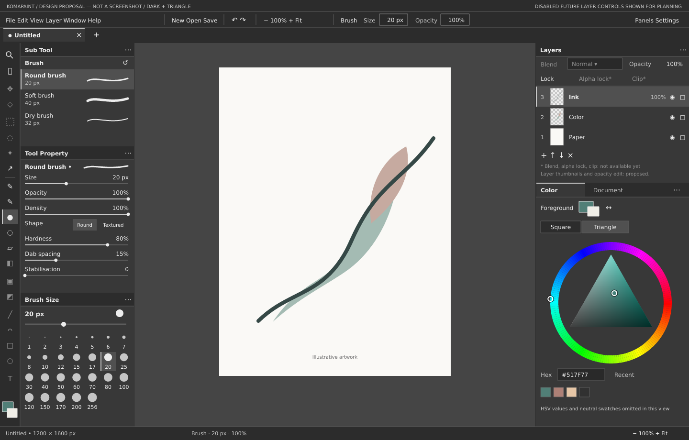
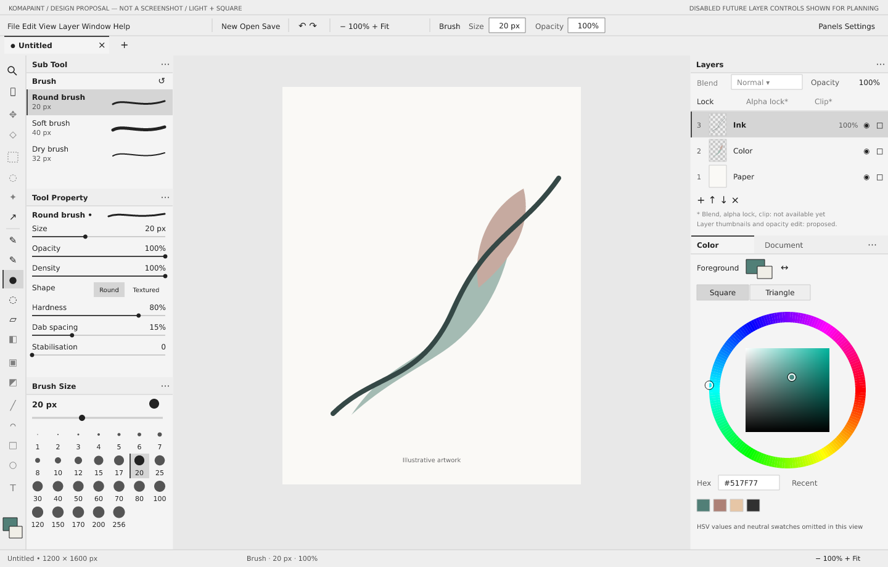

# KomaPaint interface proposal — revision 4: top-bar readout and tool rail

**Update:** [Revision 5](komapaint-interface-design-proposal-revision-5.md) supersedes this revision's layer controls and tool/tab boundary treatment. The top-bar numeric fields remain as proposed here.

**Design-only refinement; not implemented.** This updates the top bar and left tool rail in [revision 3](komapaint-interface-design-proposal-revision-3.md); all other design decisions, feature limitations and open questions in revisions 2–3 remain unchanged. No source, QML, themes, components or application assets are modified.





[Top-bar detail, 2×](design-proposal/topbar-brush-detail-proposal.png) · [Tool rail detail, 2×](design-proposal/tool-rail-detail-proposal.png) · [Dark SVG](design-proposal/topbar-rail-dark-triangle-proposal.svg) · [Light SVG](design-proposal/topbar-rail-light-square-proposal.svg)

These are **static proposals, not application screenshots**. Icons in the mockup are schematic substitutes, not proposed assets; disabled layer features and simulated thumbnails are as explained in revision 3. The large “KOMAPAINT / DESIGN PROPOSAL” line is an annotation outside the mock application, not a proposed application bar.

## 1. Top-bar brush values

```text
BEFORE:  Brush 20 px Opacity 100%
AFTER:   Brush   Size [ 20 px ]    Opacity [ 100% ]
```

- **Structure:** keep Brush in the combined single top row, with separate Size and Opacity labels and compact numeric fields. A subtle neutral inset surface and 1-unit border communicate that each number is editable; use 4–8 units between labels and fields. Keep the group aligned with other commands, rather than introducing a second toolbar or a decorative pill.
- **Proposed dimensions:** 24-unit visible field, minimum 28-unit-high interaction area where available within the 34–36-unit top row; allow approximately 60 units for each field, expanding if localized content or numeric limits require it. Use readable 12–13-unit text and right-aligned/tabular values. These dimensions are starting values for testing, not measured physical accessibility.
- **States:** resting fields have a restrained but visible boundary; hover raises boundary contrast; focused input has an independent 2-unit neutral focus outline. Typing/selection, disabled and pressed states must stay legible in both themes. Candidate resting boundary `#888888` has a calculated contrast of **4.10:1** against dark input `#292929` and **3.54:1** against light input `#FFFFFF`; it is **3.94:1** against dark chrome `#2C2C2C` and **3.06:1** against light chrome `#EEEEEE`. Check actual rendered pixels, scaling and focus/hover combinations rather than claiming whole-UI compliance.
- **Behavior:** the current [`MainToolbar.qml`](../../ui/components/MainToolbar.qml) already uses [`KpNumberField`](../../ui/components/KpNumberField.qml) bound to `Workspace.brush.size` and `Workspace.brush.opacity`. Keep typed values, range enforcement, keyboard adjustment, focus/commit/cancel behavior, existing group visibility and shared state. A displayed `px` unit is a proposal for clarity and does not change the value. The field is a **numeric editor**, not a fake slider: no drag/scrub cue is shown unless real scrubbing is separately designed and implemented. Existing Tool Property and Brush Size sliders remain available.
- **Why:** a field boundary and whitespace distinguish the editable number from its label without adding another row or reverting to large, boxed parameter panels.

## 2. Left toolbar alignment and grouping

- **Top inset:** propose 10 logical units from the rail's top boundary to its first 34-unit tool target (icon centered inside); check the actual boundary and hit area at high DPI. This creates breathing room without reducing the target.
- **Group divider:** use a short, 1-unit neutral hairline across the middle of the rail, with a 6-unit break, **before the painting tools**—after the current view/transform/selection/eyedropper groups and before Pen. It separates the selection/transform area from the painting/shape area without creating boxed sections. Preserve other existing group breaks as quiet spacing; do not remove tool access or interpret the divider as an interactive control.
- **States and functionality:** retain the one-column proposal, 34-unit tool cells, scrollability, actual tool names/assets, availability, selected-tool marker, focus/hover/pressed states, foreground/background swatches and their swap/reset behavior. The separator and inset do not change ordering, shortcuts or enablement.
- **Baseline clarification:** [`ToolPalette.qml`](../../ui/components/ToolPalette.qml) currently lists Zoom and Hand first, then Move/Transform, Selection/Lasso/Auto select/Eyedropper, then painting tools. The selection icon is currently unavailable. The revised illustration follows this ordering schematically; its first mark represents Zoom, while the dashed marquee stands for Selection farther down. The user's top-edge spacing concern is applied to the first cell regardless of icon. No selection capability or reordering is implied.
- **Why:** more clearance avoids a cramped first target; the single meaningful group divider is a physical memory cue without extra visual clutter.

## 3. Validation and unresolved decisions

After explicit implementation approval, check both themes and scaling: verify field affordances and focus, keyboard editing and shared brush state; confirm the divider follows the correct groups, every tool remains reachable by scrolling, and the new top inset does not crowd the colour pair. Check narrow-window overflow and saved toolbar visibility. The question from revision 3—**full-document versus content-cropped layer thumbnails**—is still open. No decision on it is assumed here.

No implementation, tests, CI, commit or push were performed for this design revision.
