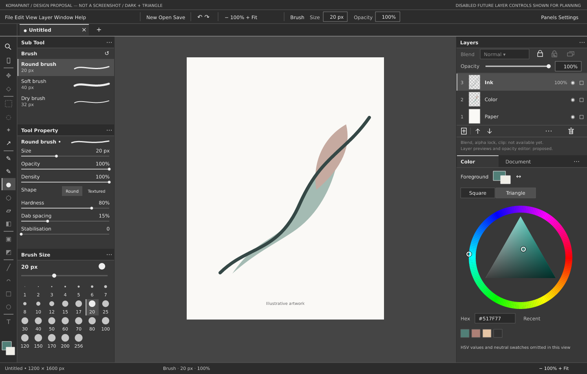
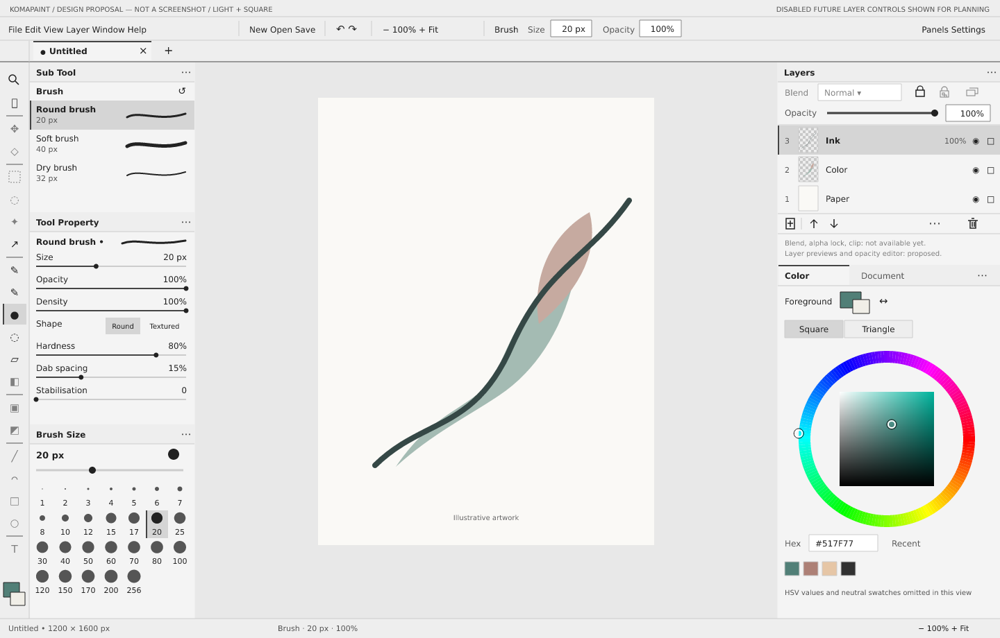

# KomaPaint interface proposal — revision 5: layer controls and tool boundaries

**Design only; awaiting approval.** This revision updates the Layers controls, tool-group separators and document-tab/rail boundary in [revision 4](komapaint-interface-design-proposal-revision-4.md). Other specifications, capabilities and unresolved questions in revisions 2–4 continue to apply. No application implementation is included.

[Layer controls detail (2×)](design-proposal/layer-utilities-detail-proposal.png) · [Rail and tabs detail (2×)](design-proposal/tool-dividers-detail-proposal.png) · [Dark SVG](design-proposal/layer-rail-dark-triangle-proposal.svg) · [Light SVG](design-proposal/layer-rail-light-square-proposal.svg)

These are schematic static illustrations, not application screenshots. Annotation text above the app and below the illustrated layer commands is explanatory, not proposed permanent chrome. Icons stand in for actual, recognisable app icons; the example thumbnails are illustrations, not generated from live layer data.

## Layer opacity and utilities

- **Opacity is for the selected layer**, not the brush. Give it a dedicated horizontal rail with a visible thumb, adjacent to a separately outlined editable percentage. The label, track, thumb and value remain aligned in a compact row directly above the stack. Clicking/dragging the rail and editing the numeric value should update the same layer opacity; keyboard access, focus, bounds of 0–100%, and a clear accessible name are required. Use the established neutral focus and hover treatments, not coloured highlights. No layer selected means a disabled control. Changing selection must immediately show that layer's value; do not apply an in-progress edit to a newly selected layer. Preserve existing undo/history and persistence expectations, verifying or implementing them before enabling the editor.
- This is **future UI work**: [`LayersPanel.qml`](../../ui/panels/LayersPanel.qml) currently displays row percentages but has no layer-opacity editor. Layer opacity exists in the model and renderer; the slider is not presented as already functional. Brush opacity in the top bar remains the existing numeric-editor proposal from revision 4, with no additional brush slider.
- Place Blend at the left of the first row, followed by three compact icon targets: ordinary lock, alpha lock, and clipping. Ordinary lock is an existing feature; blend, alpha lock and clipping are requested future features, shown disabled until genuinely supported. Tooltips and accessible names must distinguish ordinary lock from alpha lock and clipping; no ambiguous icon-only functionality. Blend remains a labelled dropdown, disabled until it is real.
- Beneath the layer stack, align recognisable icon buttons in a command strip: new raster layer, a small separator, move up/down, overflow, and delete at the far edge. Targets should remain at least 28 logical units, with icon sizes around 16 and consistent keyboard focus. The overflow is a proposed home for less-frequent existing unavailable commands (new vector, folder, adjustment, reference, mask and merge down), with labelled menu items and their unavailable status preserved; it must not silently remove actions. Check that discoverability and shortcut/tooltip behavior survive the move. Deletion remains subject to the existing last-layer constraint; up/down follow existing boundaries. Icons are schematic and need refinement, especially clip vs mask and row-level visibility/lock.
- Keep actual layer artwork previews, selection, transparency indication and hidden/empty states as specified in revision 3. The proposed thumbnails and the new opacity editor need independent implementation and testing. Blend modes, alpha lock and clipping additionally require complete model, paint/compositing, save/load, undo and tests, not merely enabled buttons.

## Tool groups and document tabs

- Make the hairline visible at **every existing tool-group boundary**: view; move/transform; selection and eyedropper; painting; fill/gradient; shapes; and text. Keep the original tool order and availability. Short neutral rules with a modest gap between groups support scanning without adding boxes. The one-column proposal retains 34-unit tool targets and scrolls if needed; the drawing is schematic and should not be measured as a hit-target specification. Keep the colour pair outside the scrollable group area.
- Reserve the top-left 42-unit-wide tab-row segment as noninteractive rail chrome. Start document tabs to its right, after a vertical boundary, and add a continuous horizontal boundary between the tab row and workspace/rail. The first tool begins below that boundary with a 10-unit top inset. **The tab and tool hit rectangles must be disjoint**, including close/new buttons, hover regions and focus outlines; the separating line alone is not the protection. Verify at different scaling factors and with multiple tabs, scrolling and overflow. Do not remove tab switching, closing or new-document access.
- Preserve the revision-4 top-bar value fields and all previous compact, neutral theme decisions. Selection/transform tools remain unavailable where the current application does not implement them.

## Validation and open decisions

After approval, test selected-layer changes while dragging/typing, cancel/commit, layer deletion, undo/redo and save/reload; ensure track clicks, keyboard and numeric editing agree on values. Verify the tab/rail hit boundaries with mouse, pen and touch, tool-group separators and rail scrolling in both themes and at multiple scales, and icon tooltips/accessibility. Validate overflow access at narrow widths. These are proposed checks, not completed tests or accessibility certification.

The revision-3 question of **full-document versus content-cropped layer thumbnails** remains unanswered. No implementation, application source changes, commit or push were made for this revision.
