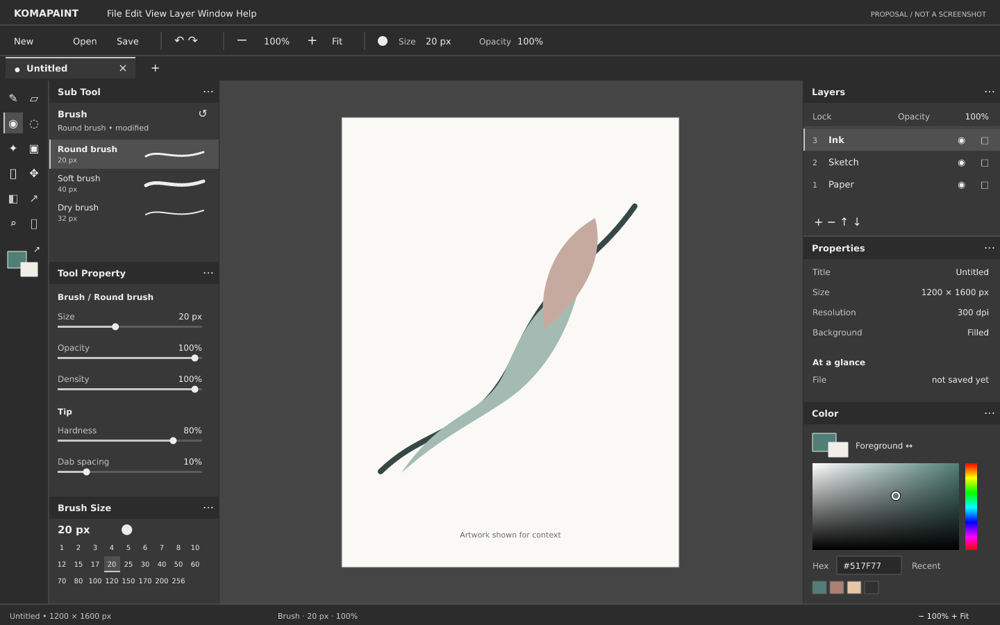
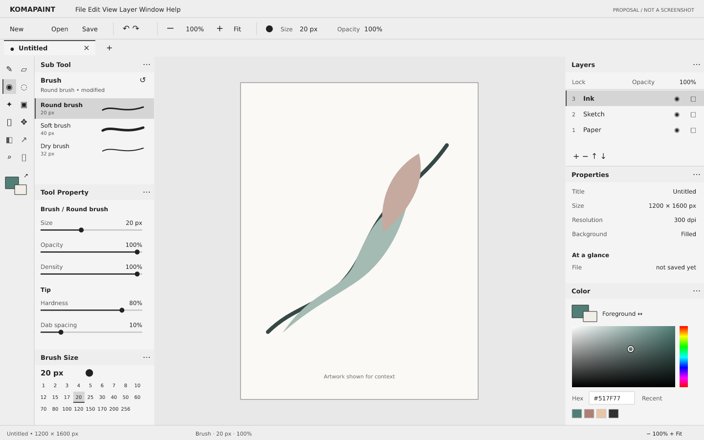

# KomaPaint interface design proposal

**Status: earlier proposal, superseded in the areas listed in [revision 2](komapaint-interface-design-proposal-revision-2.md); no implementation authorized or performed.**  
**Scope:** visual structure, interaction presentation and neutral dark/light themes. Source baseline `d3622c4869fc868ce0d52a05146b35938372b7f0`; evidence and caveats are in [professional interface research](professional-software-design-research.md), especially §§10–14. Revision 2 responds to the user's denser desktop direction, right-side panels, single top bar and colour wheel and is authoritative where it differs. No application source, components, theme or assets have been changed.

## 1. Design decision in one sentence

**A quiet production desk:** a continuous shell surrounding an unmistakable canvas, with compact but comfortable task-specific dock panels, readable names and values, and neutral state cues that never compete with the work. Identity comes from well-aligned tools and visible working context, not an accent colour, a grid of cards or an imitation of another editor.

### Decisions, not optional style directions

1. Keep the **existing default dock topology and visible panels**: left Sub Tool / Tool Property / Brush Size; canvas center; right Layers / Properties / Color. Retain existing saved and customized arrangements. Do not hide Properties or Brush Size by default without later evidence.
2. Give the shell and each panel **one continuous surface**. Distinguish panel headings by a shallow tonal band and type; use one edge per split. Rows, sliders and editable fields have different visual grammars; they are not a collection of identical cards.
3. Keep both **quick access and detailed controls**: toolbar brush size/opacity and zoom, panel editing, plus status readout and zoom. Their purposes differ. Do not remove controls or change engine behavior for visual neatness.
4. Replace the current blue/orange chrome with the neutral state system in §3. Keep actual artwork, previews, foreground/background swatches, HSV selector and colour history in true colour. The only gradients in this proposal are functional colour-selection data; no chrome gradients or glows.
5. Preserve usable information and targets. Normal labels are 12–13 logical pixels, normal row/target heights at least 28 where practical, not a smaller UI masquerading as a professional one. No critical information is relegated to hover alone.
6. Keep the timeline's current truthful limitations and behavior. No redesigned transport, exposure grid, playback promise, Xsheet or animation feature is proposed.

## 2. Visual examples and evidence boundaries





[Dark SVG](design-proposal/shell-dark-proposal.svg) · [Light SVG](design-proposal/shell-light-proposal.svg)

These are **hand-authored, noninteractive design illustrations**, not application screenshots and not pixel-perfect implementation layouts. They show one illustrative 1440×900 arrangement, a fictional document, layer names, colour and artwork. Preset names come from the source; the selected Round brush has a modified example value. Stroke paths are illustrative placeholders, **not** `BrushStrokePreview` output. The simplified artwork and colour selector are functional-colour examples, not new application assets. Unicode marks stand in for icons; actual existing icons, tool names and tooltips remain authoritative. The images omit some controls, scroll content, disabled actions, tool-property sections, dialog, actual viewport controls and state combinations for legibility. **Omission is not a proposal to remove or change a feature.** The spec below governs all of those details. Only the illustrated layout is proposed; it is not evidence that the UI was run, that this arrangement fits at all sizes, or that visual accessibility has been verified.

### 2.1 Before → after: structural diagrams

**Shell — current structure observed in source → proposed visual treatment**

```text
CURRENT (schematic, not screenshot)         PROPOSAL (same default structure)
┌ menu ─────────────────────────────┐      ┌ menu — continuous neutral chrome ───────┐
│ command groups | rules | blue/ember│      │ document   edit   view   brush           │
│ document tabs: ember active/dirty  │      │ active document ──  • unsaved            │
├ rail ┬ left docks ┬ canvas ┬ right┤      ├ rail ┬ task-specific docks ┬ canvas ┬ docks┤
│      │ Sub Tool   │        │Layers│      │      │ Sub Tool             │        │Layers│
│tools │ Tool Prop  │ artwork│Props │  →   │tools │ Tool Property        │artwork │Props │
│+ F/B │ Brush Size │        │Color │      │+ F/B │ Brush Size           │        │Color │
├──────┴────────────┴────────┴──────┤      ├──────┴──────────────────────┴────────┴─────┤
│ status: document / brush / zoom   │      │ status: document / brush / zoom            │
└───────────────────────────────────┘      └────────────────────────────────────────────┘
```

Blue/orange appearance is source-observed; perceived clutter and improvement require validation. The diagram does not claim existing panels are all cards. The proposed hierarchy reduces competing accents, not the number of panels. Panel sizes, visibility, floating state and user preferences remain adjustable.

**Preset and properties — one example of different content, common grammar**

```text
CURRENT                                      PROPOSAL
Sub Tool header + active brush               Sub Tool header + active brush
┌ selected wash + ember edge ──────────┐      ┃ neutral selected row / name + size
│ name + bordered stroke preview well  │  →   ┃ actual stroke preview, no nested frame
├──────────────────────────────────────┤        other named stroke rows
│ … individual row rules               │      [scroll as needed]
└──────────────────────────────────────┘
Tool Property: preview + micro caps/rules     Tool Property: preview + sentence-case group
slider: coloured rail + value                 slider: neutral rail + value + focus ring
```

**New Project — remove nesting, not settings**

```text
CURRENT                                        PROPOSAL
Project type                                   Project type
┌ tile ──────┐ ┌ tile ──────┐                 ┃ Illustration ✓   Comic Page (unavailable)
│ ┌ artwork ┐│ │ ┌ artwork ┐│                 │ Multi-page Comic (unavailable)  Animation (unavailable)
│ └─────────┘│ │ └─────────┘│                 [one compact group, no nested preview cards]
└────────────┘ └────────────┘                  Project name      [_____________________]
┌ settings inset + border ─────────────────┐   Width             [________] [units ▼]
│ name / width / units / height / DPI      │ → Height            [________]
│ transparency / background colour         │   Resolution        [________] dpi
└──────────────────────────────────────────┘   □ Transparent background
┌ summary inset + border ──────────────────┐   Background colour… [actual swatch]
└──────────────────────────────────────────┘   derived dimensions / error if any
┌ status inset + border ───────────────────┐   status text
└──────────────────────────────────────────┘                         [Cancel] [Create]
```

The proposed project-type group remains a set of labeled choices, with only Illustration available; the compact diagram does not prescribe a one-line layout at narrow widths. No extra project type becomes functional. Existing project-type artwork is preserved as an asset, but this proposal does not require it to appear in the compact selector; see open question Q4 before implementation.

## 3. Visual foundation

### 3.1 Dark theme tokens

All colours are opaque sRGB neutrals. Names are design roles, not a directive to edit or rename `KomaTheme` properties. If existing roles need to coexist during migration, map them explicitly and test callers.

| Role | Value | Intended use |
|---|---|---|
| Chrome / headers | `#2C2C2C` | Menu, toolbar, document strip, status and dock headers. |
| Panel / dialog | `#383838` | Continuous dock body and dialog body. |
| Editable well | `#292929` | Text/numeric input and menus where separation aids recognition. |
| Canvas surround | `#454545` | Workspace around artwork, not the artwork itself. |
| Hover | `#444444` | Temporary hover fill on panel surface. |
| Selected | `#505050` | Current row, tool, tab or checked item; pair with marker. |
| Pressed | `#5A5A5A` | Transient press; use primary text on this surface. |
| Primary text / icon | `#EDEDED` | Enabled text, values, icons, selected labels. |
| Secondary text | `#C6C6C6` | Subordinate but useful labels on panel/selected surfaces. |
| Disabled text / icon | `#909090` | Disabled controls only; include reason/semantics. |
| Structural hairline | `#5C5C5C` | Nonessential grouping; not a sole essential state cue. |
| State marker / focus | `#C8C8C8` | Selected edge, check and keyboard focus. |
| Artwork edge | `#707070` | Boundary aid, not baked into the image; test against surround and artwork. |

### 3.2 Light theme tokens

| Role | Value | Intended use |
|---|---|---|
| Chrome / headers | `#EEEEEE` | Menu, toolbar, document strip, status and dock headers. |
| Panel / dialog | `#F4F4F4` | Continuous near-white dock and dialog body. |
| Editable well | `#FFFFFF` | Text/numeric input and menus. |
| Canvas surround | `#E8E8E8` | Workspace around artwork, not the artwork itself. |
| Hover | `#E4E4E4` | Temporary hover fill on panel surface. |
| Selected | `#D5D5D5` | Current row, tool, tab or checked item; pair with marker. |
| Pressed | `#C9C9C9` | Transient press; use primary text on this surface. |
| Primary text / icon | `#222222` | Enabled text, values, icons, selected labels. |
| Secondary text | `#555555` | Subordinate but useful labels on panel/selected surfaces. |
| Disabled text / icon | `#808080` | Disabled controls only; include reason/semantics. |
| Structural hairline | `#CCCCCC` | Nonessential grouping; not a sole essential state cue. |
| State marker / focus | `#444444` | Selected edge, check and keyboard focus. |
| Artwork edge | `#707070` | Boundary aid, not baked into the image; test against surround and artwork. |

### 3.3 Contrast and state rules

Specified opaque foreground/surface checks, using the sRGB relative-luminance formula (rounded to two decimals):

| Pair | Dark | Light |
|---|---:|---:|
| Primary / panel | 10.02:1 | 14.47:1 |
| Secondary / selected | 4.72:1 | 5.08:1 |
| Primary / selected | 6.89:1 | 10.84:1 |
| Primary / pressed | 5.89:1 | 9.61:1 |
| Focus / panel | 7.01:1 | 8.86:1 |
| Focus / selected | 4.82:1 | 6.64:1 |
| Focus / pressed | 4.12:1 | 5.88:1 |

**Do not use dark secondary `#C6C6C6` on pressed `#5A5A5A`: 4.04:1.** Use primary text there. Similarly, use primary text on light pressed rather than relying on the marginal secondary pairing. Decorative hairlines and disabled controls are not asserted to pass 3:1/4.5:1. These are palette-pair checks only, not whole-UI conformance. Verify every actual rendered pair and transition, including muted opacity, edges, text, overlays, artwork and colour swatches. [WCAG contrast](https://www.w3.org/TR/WCAG22/#contrast-minimum), [non-text contrast](https://www.w3.org/TR/WCAG22/#non-text-contrast) and [focus appearance](https://www.w3.org/WAI/WCAG22/Understanding/focus-appearance.html) are useful desktop benchmarks, not an automatic compliance claim.

**Shared state grammar** (all component sections inherit this; their state notes specify adaptations):

| State | Visual decision | Behavior/legibility rule |
|---|---|---|
| Rest | Primary text on panel; secondary only for supporting metadata. No enclosing box around an ordinary action. | A visible label, recognizable icon and/or accessible name identifies the control before hover. |
| Hover | Neutral hover fill, no glow or movement. | Never replaces selected marker or keyboard focus. |
| Selected / checked | Selected fill + 2-unit leading edge for rows/tools, or selected fill + check for menus/choices; medium weight for the name. Active tab uses a 2-unit top edge. | Persistent state visible without colour or hover; active tool, document, dock, layer and preset remain different scopes. |
| Keyboard focus | 2-unit high-contrast outline **inside** the target when possible; outline remains visible with selection and pressed states. | Distinct from a selected leading/top marker. Use paired light/dark outline only when needed on variable-colour artwork/swatches; contrast must be checked against both adjacent and unfocused pixels. No glow. |
| Pressed | Pressed fill only while held, primary text; selected marker remains. | Returning to rest must not erase persistent selection. |
| Disabled | Disabled token and disabled semantics; no hover/press response. Preserve text or an accessible explanation of why unavailable. | Disabled is not a method of visually quieting information that must be read. Unavailable features remain visibly labeled and cannot be activated. |
| Error / warning | Neutral warning shape + explicit text + affected field and next action. Border may use focus token, with error text, not red/colour alone. | Keep errors readable and announced. Never let a warning be merely a decorative icon. |
| Unsaved / edited | Neutral dot plus accessible text/tooltip (“unsaved changes” / “preset modified”). | The dot is separate from selected edge and keyboard focus; announce state even when the dot is clipped. |

### 3.4 Type, geometry and surfaces

- **Typography:** UI sans (existing Inter preference with platform sans fallback); body and field labels 12–13 logical px, panel headings 13 medium, status and secondary 12, dialog heading 16 medium. Numeric fields and changing values use tabular digits where supported. Use sentence case for panel groups and labels. Do not make essential labels 9 px tracked capitals. These are starting values in Qt logical units, subject to actual system scaling and localization.
- **Spacing:** 4-unit base; 4 between a label and value, 8 within a related group, 12 between groups, 12 panel inset, 16 dialog inset. Dense lists may use flush rows. Keep long content scrollable; never rely on fixed English text fitting.
- **Dimensions:** menu 30, toolbar 40, document strip 32, dock header 32, status 28, list rows 32 and preset rows 44 nominal logical units. Preserve 34-unit tool cells; minimum 28-unit routine target, 32–34 for frequent tools; 24 is an exception only where generous spacing and input testing support it. A glyph can be smaller than its hit region. These are proposals, not proof of target accessibility. Status grows 24→28 to accommodate 12-unit text; validate canvas impact.
- **Shape:** neutral 0–3-unit radius on controls; one 1-unit functional divider at dock boundaries and fields, 2-unit focus outline. No visual drop shadow, colorful perimeter, extra section card, floating tile or ornamental separator. The artwork boundary/checkerboard remains functional.
- **Scaling and overflow:** give panel content and artwork priority over empty space. Keep the existing dock min-size, scrolling, collapse, float and tab behavior; ensure 12-unit labels and full targets at high DPI, long names and localization. Toolbar's current responsive hiding of the brush group below its width threshold is retained, with alternate brush access preserved. Any further overflow redesign requires separate approval/testing. Do not reset existing user layouts for new dimensions.

## 4. Component-by-component decisions

Every component inherits the complete hover / selected / focus / pressed / disabled grammar in §3.3; notes below say how it is applied. “Better” means a reasoned expected benefit, **not** a proven usability improvement. Current source has not been rendered or measured in this phase.

### 4.1 Main shell and toolbar

- **Structure and hierarchy:** keep menu, four toolbar groups (document, edit, view, brush), document strip, two-column tool rail, dock workspace, canvas and status in their current order. Align 40-unit toolbar controls on a common baseline; a 12-unit gap separates groups, with a single short rule only where spacing alone fails. Use text for New/Open/Save and recognizable icons for Undo/Redo/zoom. Maintain the panel/preferences controls already present.
- **Surface/type:** chrome `chrome`; 12–13 text; no individual background box at rest; 28–32-unit targets. Panel and canvas edges provide orientation, not decorative containers.
- **States:** toolbar hover/press fills; checked controls get fill + check/edge; enabled focus has the separate outline; disabled actions remain visible and explainable. Hidden groups remain user-configurable as now.
- **Preserve:** every current action, shortcut, enable condition, group customization, threshold behavior, viewport and saved preferences. Toolbar and status zoom remain distinct access points.
- **Expected improvement:** grouped alignment and restrained state colour should make document/brush actions findable while drawing less attention than repeated colourful controls; retained controls prevent cosmetic minimalism.

### 4.2 Tool palette

- **Structure:** retain existing two columns, 34×34 target cells and scroll behavior. Current tool gets selected fill + 2-unit leading edge; keep foreground/background swatches and swap in their existing functional cluster. Tooltips and accessible names identify icons; distinguish not-yet-available tools from temporarily disabled ones in their existing wording.
- **Surface/type:** rail uses chrome; icons are 18–21 logical px with neutral tint when they represent chrome. Use existing icon artwork, not substitute Unicode mockup glyphs.
- **States:** hover and pressed affect only the cell; selected edge stays visible; focus outline is separate; disabled icon and tooltip/reason remain. Actual foreground/background colours must not be desaturated; use a two-tone outline if the swatch matches the UI.
- **Preserve:** tool ordering, availability, current selection, cursor/shortcuts, scroll reachability and colour swap.
- **Expected improvement:** one neutral, spatially consistent active cue reduces the prominence of chrome without concealing tool state or availability.

### 4.3 Brush presets and stroke previews

- **Structure:** a 32-unit dock header, current tool and current preset with reset command, followed by flush 44-unit preset rows. Each row has name and size at left and the **real** stroke preview at right; use scroll instead of shrinking. Mark modified preset with a neutral dot and accessible text. Do not draw a box and separator around every preview unless contrast against its actual background requires a functional preview field.
- **Type/spacing:** name 13 medium when selected, size 12 secondary; 12-unit inset, 8-unit gap. Keep full name in accessible label/tooltip when elided.
- **States:** selected fill + leading edge; hover/press distinct; focus outline may coexist; reset is disabled when no modification and retains its explanation.
- **Preserve:** current active-tool grouping, exact preset values, live `BrushStrokePreview` rendering, selection, modified tracking, reset and model synchronization. No new preset creation/search feature.
- **Expected improvement:** the stroke and name carry the distinction rather than a nested border and accent; users still see precisely what each available preset does.

### 4.4 Tool properties and brush size

- **Structure:** Tool Property begins with current tool/preset and real preview, then sentence-case groups **Stroke**, **Tip**, **Correction**, with existing size, opacity, density, hardness, spacing, stabilization and existing controls intact. Each slider retains visible numeric value and unit on the right, with a 3–4-unit neutral rail and a clearly visible thumb. Brush Size retains readout, tip preview, continuous rail and the full 26-step grid; don't fold away the grid by default.
- **Type/spacing:** 12–13-unit labels and values, 8 between sliders, 12 between groups; labels and values share predictable edges. Size-grid cells target 28 units where feasible and wrap or scroll without losing items; nominal compact mockup is not a target-size measurement.
- **States:** slider/thumb hover and pressed adjust tone, focus outlines surround the control or numeric editor, selected grid size has fill + marker. Unavailable properties remain labeled and disabled; selection and focus coexist.
- **Preserve:** `Workspace.brush` shared state; exact ranges, nonlinear size curve, editing, drag, fine adjustment, keyboard and wheel behavior, reset where supported, grid ladder and `[`/`]` shortcuts. No new control behavior is implied.
- **Expected improvement:** stronger labels and aligned values reduce visual interpretation effort; shared-state access remains wherever it is useful rather than being removed as “duplicate.”

### 4.5 Layers

- **Structure:** header, existing selected-layer attributes/commands, a flat list of 32-unit rows, and existing action bar. Each row aligns layer number/type/name and visibility/lock in stable columns; selected row has neutral fill, leading edge and medium name. Preserve the actual opacity **readout** and existing unavailable operations, with their current enablement. The model supports opacity but this panel does not expose an editor; revision 2 proposes one separately. No invented thumbnails.
- **Spacing/type:** name 13; secondary data 12; 8-unit internal alignment. Elide long names and expose full name accessibly; keep controls at least 28-unit targets where feasible.
- **States:** row selection remains when a visibility/lock button has keyboard focus; hover/press are local to row or action. Hidden and locked states use their existing icon semantics as well as accessibility labels, not low opacity alone. Disabled actions remain identifiable.
- **Preserve:** model order and selection, layer type information, raster actions, visibility, lock, opacity, shortcuts and disabled/unavailable controls; no engine changes.
- **Expected improvement:** the row is legible as a layer record instead of an accent highlight; stable columns make selected and inactive rows comparable.

### 4.6 Colour

- **Structure:** keep two working swatches/swap, saturation–value plane, hue strip, hexadecimal value, session recent colours and existing neutral swatches. The selector is a working surface, not a card; thin boundaries protect the picker against similar adjoining colours.
- **Spacing/type:** 12-unit panel inset, 8 between swatch/selector/field groups; exact hex stays editable and legible in 12–13-unit text. Plane and rail remain large enough for accurate pointing; scroll rather than crush.
- **States:** use a two-tone black/white ring around the plane/hue marker to remain visible on arbitrary colours. Swatch selection uses outline + marker/accessible label, never hue alone. Hover/press/focus follow §3.3; disabled applies only where functionally necessary.
- **Preserve:** actual hue/saturation/value gradients, exact colours, remembered hue for grayscale, foreground/background, swap, hex editing and session-only recent-colour behavior. This is the **functional exception** to the no-gradient chrome rule.
- **Expected improvement:** neutral surrounds leave colour judgment to the actual instrument and canvas while an adaptive ring remains readable across bright and dark colours.

### 4.7 Document properties

- **Structure:** one flat labeled definition/form layout: Title, Size, Resolution, Background; then “At a glance” for pixel count, history and file. Labels left, values aligned right where width permits; wrap or stack in a narrow dock. Do not imply a read-only value is editable or vice versa.
- **Spacing/type:** 12-unit inset; 28–32-unit rows; 12-unit secondary labels and 13-unit values; one 12-unit group gap instead of nested inset rectangles.
- **States:** fields and transparency switch use shared hover/press/focus; on/off is indicated by position **and** “Transparent”/“Filled” text, not fill alone. Disabled fields retain meaningful explanation. Read-only items have no fake hover.
- **Preserve:** every existing property, whether editable or read-only, its actual scope, dimensions/resolution/background semantics and default visibility.
- **Expected improvement:** clearer distinction between current document facts and editable controls without taking away information.

### 4.8 Docking and panel tabs

- **Structure:** one 32-unit header/tab strip per existing dock group, flat body, one boundary per adjacent region. Panel names remain visible; active tab uses medium label + neutral top/bottom edge; inactive labels remain readable. Keep close, collapse, drag and floating title controls. Splitter retains a generous invisible hit area even if the visible line is 1 unit.
- **States:** hover shows tab/handle feedback; active tab and keyboard-focused tab have distinct edge/outline; pressed/dragging retain active marker; disabled actions remain clearly disabled. Dock drop preview uses a neutral outline plus shape/position and must remain visible against content; avoid obscure artwork or hide drop target.
- **Preserve:** `DockModel` IDs/tree, split/tab/float/hide/collapse, drop-zone geometry, canvas lifetime, named layouts, reset, restore, and current user layouts. No automatic workspace migration or default rearrangement.
- **Expected improvement:** fewer coincident panel borders show hierarchy without visually framing every piece of content; direct manipulation remains discoverable.

### 4.9 Document tabs and status bar

- **Structure:** active document tab is connected visually to workspace with a 2-unit top rule and medium title; inactive tabs use chrome, active tab panel tone. A neutral dot before the title indicates unsaved changes and has accessible text. Preserve close/new and scrolling; reserve a target for close even if the glyph is quiet.
- **Status:** one 28-unit strip, 12-unit text. Left: document name/dimensions and file/modified state where currently shown; middle: tool, brush size/opacity; right: existing zoom out/value/in/fit. Keep numeric values tabular and enable the same menus/actions.
- **States:** inactive/hovered/selected/pressed/focused tabs are distinct; close and new have their own focus/hover. Status controls use same grammar; facts are not disguised as buttons. Unsaved marker never doubles as focus.
- **Preserve:** tab identity, activation, closing prompts, new project, modified-state tracking, session/recovery behavior and all existing status/zoom actions. No changes to close flow.
- **Expected improvement:** visible document identity and unsaved state without two competing accent colours, while status keeps quick confirmation and view access.

### 4.10 New Project dialog

- **Structure:** one 520-unit content column (shrink within available window and scroll as needed), 16-unit outer padding. Heading; compact project-type group with Illustration selected and the other three labeled unavailable; name; width/unit, height, resolution; transparency/background controls; derived size summary; status/error text; footer actions. Keep the exact current form semantics and order except removal of decorative nested wrappers.
- **Type/borders:** 16-unit heading, 13-unit labels/values, 12-unit help/status; 8 between related fields, 12 between groups. Input borders signal editability; no framed summary or status cards. Preserve full-colour background swatch. Existing project artwork may be omitted from this selector but assets remain untouched, pending Q4.
- **States:** choice selection is neutral fill + check, focus outline remains separate; unavailable types have text and explanation rather than an enabled-looking tile. Controls show hover/press/focus; transparent setting disables background picker per existing behavior. Error text identifies correction, not merely a coloured outline.
- **Preserve:** Illustration-only creation, name, physical dimensions, unit conversion, DPI, transparency/background, derived pixel/inch summary, validation, creation error reporting, Cancel/Create and close-on-success semantics.
- **Expected improvement:** fewer nested boxed surfaces emphasize the form and consequence without removing inputs or misrepresenting unsupported project types.

### 4.11 Menus, buttons, popups and shared controls

- **Structure:** keep `KpButton`, `IconButton`, `KpMenu`, `KpMenuItem`, `KpTextField`, `KpNumberField`, `KpSpinBox`, `PropertySlider`, `KpScrollBar`, `KpDialog`, `KpGlyph` and `KpIcon` as shared concepts. Menus use a single `input` surface, 1-unit boundary, left-aligned labels, right-aligned shortcuts/checks and 28-unit rows; separators only between real command groups. Popup edges must remain visible over artwork.
- **Buttons and fields:** quiet neutral idle button; primary action uses selected-toned fill, medium text and a 1-unit outline rather than an accent. Destructive commands are identified by explicit text and confirmation as currently implemented, not colour alone. Fields have neutral input surface, functional boundary and a clearly distinct focus outline. No misleading affordance on labels.
- **States:** shared grammar §3.3 for idle, hover, checked/selected, focus, pressed and disabled. Menu checks remain visible while focused; slider focus distinct from selected fill. Scrollbars and splitters expose larger hit zones than their thin marks. Error messages have icon/wording and accessible association.
- **Preserve:** existing APIs, actions, shortcuts, tooltips, accessibility names, numeric range/precision, dialogs, menu close/keyboard handling, and rendering of existing icon assets. Do not invent menu entries or replace components in the proposal phase.
- **Expected improvement:** a consistent set of interaction signals reduces relearning while specialized controls keep their own geometry and purpose.

### 4.12 Both themes and current animation panel

- **Themes:** use matching semantic roles and identical layout, labels and behavior in dark and light. Change only neutral surface and foreground values; do not invert functional artwork or colour selector data. The near-white theme is not a tinted pastel version of dark.
- **States:** all states, error messages, swatch rings, tab markers and disabled explanations must be tested in **both** modes. Neither theme may rely on a coloured outline to communicate focus or selection.
- **Timeline:** leave its functional design and current explicit “Frame timing is not editable yet” communication intact. If its existing chrome later adopts shared neutral tokens, retain frame selection, current-frame indication and existing controls exactly; do not imply playback/exposure editing works.
- **Preserve/benefit:** theme choice and the honest feature boundary survive; contrast and visual consistency improve in principle without presenting an imagined animation product.

## 5. What changes and what does not

| Proposed visual change, subject to approval | Explicitly unchanged |
|---|---|
| Neutral token roles; no blue/orange decorative chrome. | Accurate colour of artwork, previews, selectors, swatches and stored values. |
| Sentence-case group headings, readable typography, aligned rows and values. | All current content, tool/brush/layer/document semantics, ranges and update paths. |
| Neutral selection marker separate from focus and unsaved/modified dots. | Selection/keyboard behavior, dirty prompts, error/recovery flows and accessibility intent. |
| Fewer nested project tiles and decorative rules; continuous panel surfaces. | Existing fields, available/unavailable types, validation and creation behavior. |
| Larger nominal interactive targets where space permits. | Existing shortcuts, scrolling, responsive access and current panel arrangement. |
| Single functional edges on dock boundaries, tab and drag feedback. | Dock tree/IDs, panel existence, current defaults, persistence, floating, collapse and user layouts. |
| More legible status and supporting text. | Status facts, zoom actions, tool access and document state. |

No source code, QML, C++, application theme, assets, model, component, CI, commit or push is changed by this proposal. The new visual files in this documentation directory are proposal artifacts only.

## 6. Unresolved decisions requiring review

1. **Actual visual baseline and fit:** current screenshots and task tests are missing. Are proposed 28-unit status, 44-unit preset rows and 32-unit layer rows practical at 1024×640 and with system text scaling? If not, retain readability and use scrolling/collapse rather than shrinking controls.
2. **Focus and keyboard access:** several source controls use `Qt.NoFocus`. Which need keyboard navigation added or restored, and how can this be done without conflicting with canvas shortcuts? The outline specification is not evidence that these controls currently accept focus.
3. **Selected state in dense lists:** can a neutral leading edge plus weight be recognized in both themes and under selected+focus+hover conditions? Validate in rendered UI, not only these mockups.
4. **Project-type imagery:** should existing full-colour project illustrations remain visible, be reduced, or be omitted from the compact selector? They are already assets and must not be modified in this phase. Test discoverability before deciding; unavailable types remain labeled either way.
5. **Disabled future tools and commands:** should not-yet-available actions continue to appear in place, be grouped, or use another presentation? Preserve current default visibility until a separate decision; never imply availability.
6. **Stroke preview contrast:** should previews use the current colour, a neutral preview surface, or an existing engine rendering rule? Preserve actual behavior until checked; do not replace real previews with symbolic paths from the mockup.
7. **Pane/header tone and border contrast:** do header bands and splitter boundaries remain legible on both themes, mixed adjacent backgrounds and platform scaling? Should splitters use a redundant grip shape where needed?
8. **Colour markers:** validate dual-tone indicators against the entire HSV plane, very light/dark swatches and transparency checkerboard; determine whether a neutral selected swatch outline needs a contrasting inset.
9. **Copy and localization:** do names, status facts, units, error explanations, translated labels and right-to-left layouts fit without losing accessible text? This proposal does not claim RTL behavior exists.
10. **Type and icon rendering:** validate Inter fallback, numeric tabularity, existing PNG/SVG glyph optical weight, high DPI and physical pen target size on supported platforms.
11. **Focus/error accessibility:** select appropriate screen-reader announcements and a disabled-reason mechanism for each control; validate all contrast pairs and focus indicators in their rendered states. WCAG benchmarks are not a completed accessibility audit.
12. **Scope of timeline visual tokens:** how to apply shared neutral tokens without implying a finished animation system or inadvertently changing its existing controls? No timeline redesign is approved here.

## 7. Proposed implementation order — only after explicit approval

| Order and dependencies | Proposed work | Regression risks / acceptance checks |
|---|---|---|
| **0. Baseline and approval** | Obtain current dark/light screenshots and record default + saved-custom layouts, scaling, visible row counts and task baselines; review unresolved questions. No implementation until approved. | Prevents confusing design mockups with actual screenshots; preserve evidence of existing behavior. Include keyboard, pen, localization and both themes. |
| **1. Shared neutral roles and state grammar** | Agree on semantic role mapping and all state combinations, then apply through existing theme/shared control APIs in an authorized implementation phase. No local one-off colour substitution. | Missed literals, alpha blending, insufficient contrast on pressed/focus; accidental recolouring of artwork/colour controls. Check every contrast pair, focus/selection distinction, warnings, both themes and preference switching. |
| **2. Shared primitives** (after 1) | Apply typography, targets, control states and border rules to buttons, fields, menus, sliders and dialog shell while retaining APIs. | Keyboard focus, input ranges, precision, popup clipping, shortcut handling and action enablement may regress across many screens. Test each shared control under hover, focus, selected, pressed, disabled and errors. |
| **3. Shell, document strip and status** (after 1–2) | Update visual surfaces, group spacing and hierarchy without changing actions or hiding existing groups. | Toolbar overflow and saved visibility, status clipping, tab focus/close hit targets, per-document state and close/save/recovery behavior. Test narrow widths, multiple documents, modified tabs and zoom. |
| **4. Dock chrome** (after 1–2; independent of 3 once roles fixed) | Update tab/header/splitter visual treatment and focus/drop feedback; retain the model. | Drag/drop hit geometry, split min sizes, canvas lifetime, floating windows, saved and named layouts, reset and restore. Test the same user layout before/after; no reset/migration without separate consent. |
| **5. Tool, brush, layers and colour panels** (after 1–2 and compatible dock chrome) | Restyle each specialized content view, verify real preview and edit flows. | Shared brush synchronization, preset modified/reset state, slider fine editing, layer ordering/locks, colour values/hue history and foreground/background swap. Test state changes across every entry point and two themes. |
| **6. Properties and New Project** (after shared fields/dialog) | Flatten decorative nesting, retain all values, type availability and messages. | Units/DPI rounding, transparent-background enablement, validation/creation errors, accessibility and success/cancel behavior. Compare before/after output, not only visual appearance. |
| **7. Full verification and iteration** (after all accepted work) | Compare screenshots and task outcomes; test scaling, keyboard/pen, screen reader, text truncation, color contrast, small window and saved layouts; address deviations. | Visual simplification could reduce discoverability or canvas space; test subjective concerns and real error rates. Existing incomplete timeline must remain honestly labeled. No release/compliance claim without complete validation. |

**Approval requested:** review the overall direction, the neutral token and state rules, preservation boundaries, and unresolved questions before any implementation. Stop here.
